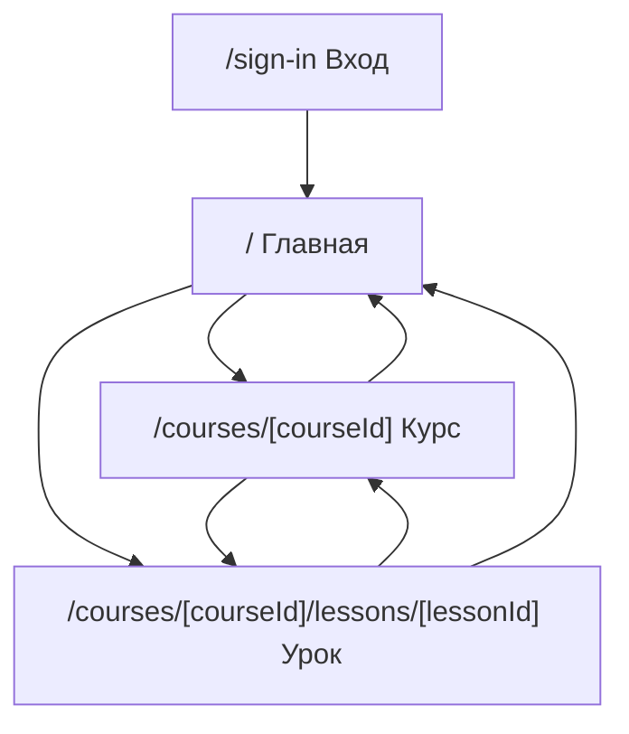

# Information architecture: learner journey

Issue #50, architect phase. Facts behind every decision: `plans/50-learner-flows-design-system-research.md`
(cited below as "research §n"). Scope of this PR: `plans/50-learner-flows-design-system-design.md`.

Notation: `F6` in backticks is the keyboard key; F6 without backticks is the flow "Open a lesson whose
prerequisites are not passed". R1-R6 are the interaction rules below; flows refer to them by id instead
of restating them.

## Vocabulary

One term per concept, in docs and in UI copy. Sources: `course/`, `docs/learning-process.md`,
`packages/lesson-schema` (research §2).

| Concept | English (docs, ids) | Russian (UI) | Note |
|---------|---------------------|--------------|------|
| course | course | курс | |
| module | module | модуль | |
| lesson | lesson | урок | never "занятие", never "класс" |
| theory | theory | теория | |
| task | task | задание | |
| working folder (the files) | working folder | рабочая папка | the files from `starter/`, kept in a volume |
| environment (the running container) | environment | окружение | decision A1 in the design file. `workspace` appears only as the `lesson.yaml` field name (and in the image name `academy-workspace` it holds); docs never call the container a "workspace" |
| check | check | проверка | |
| attempt | attempt | попытка | |
| quiz | quiz | квиз | |
| mentor | mentor | ментор | |
| mentor review | mentor review | разбор | from task.md "разбор с ментором"; the action is always "Разобрать с ментором" |
| hint | hint | подсказка; levels "Вопрос", "Направление", "Скелет", "Скажи прямо" | learning-process §3 |
| outcomes | outcomes | "Чему научитесь" | the schema field `outcomes` |
| prerequisites | prerequisites | "Сначала пройдите" | |
| terminal | terminal | терминал | |
| editor | editor | редактор | |
| lost connection | connection | соединение | "Соединение с терминалом потеряно", "Соединение с проверкой потеряно"; never "связь" |
| page region | region | "Верхняя панель", "Уведомления", "Урок", "Проверка", "Окружение" | the stops of the `F6` cycle, see Navigation model |

### Closed status sets

Every status the UI shows comes from exactly one of these sets. A set holds base labels plus named
variants; a variant is listed here verbatim (with `N`, `M`, `$N`, `<...>` as placeholders) or it does not
exist. "When" says which release shows it: v1 (this PR's prototypes), or the deferred design that owns it
(D1-D5 in the design file).

| Set | Labels (Russian, exact) | Where | When |
|-----|-------------------------|-------|------|
| lesson status (masculine, agrees with "урок") | "Не начат", "В процессе", "Пройден", "Не пройден" | catalog rows (F5.3), dashboard (F4, F18) | v1; "Не пройден" only once checks can close (D1, F14.4, assumption A9) |
| module status (masculine, agrees with "модуль") | "Доступен", "Готовится" | catalog module list (F5.1), dashboard module rows (F18.2) | v1. "Доступен": has `ready` lessons; "Готовится": `planned`, or `ready` with no `ready` lesson |
| lesson type | "теория", "квиз", "артефакт", "оценка агента", "поиск багов", "проект" | lesson header (F7.1), dashboard card (F4.1), catalog rows (F5.3) | v1; the schema `type` values |
| check status (one check; neuter "пройдено" as in task.md) | base: "Не запускалась", "В очереди", "Идёт", "Пройдено", "Не пройдено", "Время вышло", "Ошибка формата, попытка не засчитана", "Не удалось запустить проверку", "Закрыта: не пройдено"; variant: "Не пройдено: исчерпан бюджет $N" | check rows in Проверки (F13.3), quiz check row (F15), recent attempts (F18.3) | the table in `checks.md` maps each to its token and release |
| check row note | "Неудачных попыток: N", "Неудачных попыток: N из M", "Осталась 1 попытка", "лимит M:SS"; running timer "M:SS из M:SS" | open check row (F13.5, F14.1), timeout row (F13 errors) | v1 "Неудачных попыток: N", "лимит M:SS" and the timer; D1 "из M" and "Осталась 1 попытка" |
| check bar status line | "Идёт проверка", "Пройдено: N из M", "Урок пройден", "Соединение с проверкой потеряно. Переподключаемся..." | check bar (F13); empty before the first run | v1 except the lost-connection text (D1) |
| disabled reason (R1 description, never a status line) | "Окружение запускается, проверка станет доступна после запуска", "Сначала запустите окружение", "Дождитесь окончания проверки", "Доступно, когда окружение работает", "Проверка уже идёт в другой вкладке", "Откроется, когда проверка будет закрыта" | "Проверить" (F13), "Действия" items (F11), hint levels (F17) | v1 except "Проверка уже идёт в другой вкладке" (D1) and the hint lock (D3) |
| environment status (status bar) | base: "Создаём окружение", "Запускаем окружение", "Окружение работает", "Окружение остановлено. Файлы в рабочей папке сохранены. Запущенные процессы завершены."; variants: "Окружение остановлено: превышен лимит <памяти \| процессов \| CPU>. Файлы сохранены.", "Docker не запущен. Запустите Docker Desktop и нажмите "Повторить".", "Нет образа окружения academy-workspace. Соберите его (см. README) и нажмите "Повторить".", "Нет доступа к этому окружению."; appended notes: "Запуск идёт дольше обычного", "Рабочая папка сброшена", "Рабочая папка не найдена, создано новое окружение из исходных файлов урока.", "Ключ API для агента не задан: агент в терминале не запустится. Добавьте ключ в .env и перезапустите платформу." | environment status bar (F8, F10, F11) | v1 |
| terminal connection (status bar) | "Соединение с терминалом потеряно. Переподключаемся...", "Не удалось переподключиться", "Сеанс терминала завершён" | environment status bar (F9) | v1 |
| one-pane switch suffix | "остановлено", "ошибка" (appended to the accessible name of the tab "Окружение") | the switch "Урок / Окружение" (A8) | v1 |
| page alert (region "Уведомления") | "Сессия закончилась. Файлы в рабочей папке сохранены.", "Окружение остановится через N мин без активности. Файлы сохранятся." | every page with the top bar (F2.1), lesson (F10.1) | v1 |
| quiz (D2) | "Нужно N%", "Попытка N из M", "Несколько вариантов", "Ответьте на все вопросы: осталось N", "Результат: N%. Нужно N%.", "Квиз пройден", "Ответы не отправлены. Попробуйте снова.", "Не удалось загрузить квиз" | Квиз tab (F15) | D2, after #36 |
| mentor (D3) | "Ментор читает попытку", "до $N", "Оценка N из M, нужно N", "Стоимость разбора: $N", "Разбор готов", "Бюджет на разбор исчерпан", "Ментор не ответил", "Ключ API не задан, разбор недоступен. Добавьте ключ в .env.", "Ментор не видел транскрипт работы с агентом" | review block and hint ladder in Проверки (F16, F17) | D3, after #37 |
| budget (D1) | "Проверка с агентом потратит до $N" | budget confirmation (F13.1) | D1, after #39 |
| editor (D5) | "Загружаем редактор", "Редактор не отвечает" | Редактор tab (F12) | D5, after #40 |

### Page copy

Messages, headings and notes that are not statuses, by page. The same closure holds: a flow quotes UI
text only from this list or from the two tables above and below. Quotes of course files (task.md, such as
"скелет" or "Сброс урока или рабочей папки счётчик не обнуляет") are sources, not UI text.

| Page | Copy (Russian, exact) |
|------|----------------------|
| sign-in (F1, F3) | "Вход" (`<title>` and h1), field labels "Почта" and "Пароль", "Входим..." (busy label of "Войти"), "Неверная почта или пароль", "Не удалось связаться с сервером. Проверьте, что платформа запущена (docker compose up), и попробуйте снова.", "Введите почту", "Введите пароль", "Слишком много попыток входа. Подождите и попробуйте снова.", "Пользователя создаёт скрипт seed, см. README", "Вы вышли" |
| dashboard (F4, F18) | "Следующий урок", "около N мин", "Не удалось загрузить курс", "Прогресс недоступен, показан первый урок", "Все доступные уроки пройдены", "Новые модули появятся в каталоге", "В курсе пока нет готовых уроков", "Пройдено уроков: N из M", "N из M уроков", "N из M", "Пока нет пройденных уроков", "Прогресс недоступен"; D4: "Слабые темы", "Слабых тем пока нет" |
| catalog (F5, F6) | "Не удалось загрузить курс", "Прогресс недоступен", "Уроки модуля готовятся", "Сначала пройдите: <lesson title>"; not-found "Страница не найдена" |
| lesson tabs | left pane "Теория", "Задание", "Проверки", "Квиз" (D2); environment "Терминал", "Редактор" (D5); one-pane switch "Урок", "Окружение" |
| lesson (F6-F13, F19) | "около N мин", "Чему научитесь", "Содержание", "Источники", "проверено <date>", "Не удалось загрузить текст урока", "Не скопировано, выделите текст вручную", "Окружение и проверки появятся в следующей версии платформы" (M0 lesson only), the key hint "`F6` или Ctrl+Shift+. (клавиша Ю): следующая область" (macOS: "`F6` (Fn+`F6`) или Ctrl+Shift+. (клавиша Ю): следующая область"), the split handle's accessible name "Граница панелей" and its tooltip "Перетащите или щёлкните, чтобы сменить ширину" (F9.3), the reset dialog "Сбросить рабочую папку?" with "Файлы урока вернутся к исходным, ваши изменения пропадут. Счётчики попыток не обнулятся.", the tab name "Проверки, идёт проверка" (visually hidden part during a run), "История попыток", "Попыток пока нет. Нажмите "Проверить", когда будете готовы.", "История попыток недоступна" (D4). The Задание tab renders task.md's own headings ("Что в рабочей папке", "Что сделать", "Что значит "готово"", "Как проверяется", "Попытки и подсказки") as written |

### Action labels

One Russian label per action. A button with the same job has the same label on every page. "v1" says
whether the control is shown in v1; a hidden control appears only when its issue ships (rule R6).

| Action | Label | Flows | v1 |
|--------|-------|-------|----|
| skip to the content | "К содержимому" | every page | yes |
| open the dashboard (top bar) | "Академия" (brand link), "Главная" (nav link) | F4 | yes, every page with the top bar |
| open the catalog (top bar, lesson breadcrumb) | "Курс" | F5 | yes, from #30 (R6, "Before the catalog ships") |
| sign in | "Войти" | F1 | yes |
| sign in again after expiry | "Войти снова" | F2 | yes |
| sign out | "Выйти" | F3 | yes |
| open the next lesson | "Начать" (lesson not started, R5) / "Продолжить" (started) | F4 | yes |
| open the catalog | "Открыть курс" | F4, F5, F8 | yes, from #30 (R6, "Before the catalog ships") |
| retry a failed load or start | "Повторить" | F1, F4, F5, F7, F8, F13, F15, F16, F18, F19 | yes where its flow is v1 (F1, F4, F5, F7, F8, F18); F13 runner error D1; F15 D2; F16 D3; F19 D4 |
| expand / collapse the outcomes | "Показать все" / "Свернуть" | F7 | yes |
| copy a code block | "Копировать" | F7 | yes |
| start a stopped environment | "Запустить снова" | F8, F10 | yes |
| keep the environment alive | "Продолжить работу" | F10 | yes |
| open the environment actions | "Действия" | F11 | yes |
| restart the environment | "Перезапустить окружение" | F11 | yes |
| reset the files | "Сбросить рабочую папку"; dialog buttons "Сбросить" / "Отмена" | F11 | yes |
| toggle the terminal screen reader mode | "Режим для экранного диктора" (a checkbox item in "Действия") | F9, F11 | yes |
| reconnect the terminal | "Переподключиться"; new shell "Открыть новый сеанс" | F9 | yes |
| show raw error details | "Подробности" | F8, F13 | yes in F8; F13 runner error D1 |
| run the checks | "Проверить" | F13 | yes |
| open the results | "Открыть результаты" | F13 | yes |
| move focus to the environment | "К окружению" | F13 | yes |
| confirm a paid check | "Запустить" / "Отмена" | F13 | no, D1 (#39) |
| take the quiz | "Пройти квиз"; send "Отправить ответы" | F13, F15 | no, D2 (#36) |
| ask for a review | "Разобрать с ментором"; reply "Ответить" | F13, F14, F15, F16 | no, D3 (#37) |
| ask for a hint | "Попросить подсказку"; next level "Следующая подсказка" | F13, F17 | no, D3 (#37) |
| reload the editor | "Перезагрузить редактор" | F12 | no, D5 (#40) |

## Interaction rules

Each rule is stated once here. A flow that has a case of it names the rule and adds only its own data
(which control, which reason).

### R1: disabled actions with a reason

A control that cannot act now but will act later stays in its place and stays focusable:
`aria-disabled="true"` (never the native `disabled` attribute, which removes it from the Tab order), and
activating it does nothing. Its reason is visible text next to it (`muted-foreground`), tied to it with
`aria-describedby`, so Tab reaches the control and a screen reader reads why. The reason is never put in a
status line or a live region: a status line reports what happened, not what is blocked. The reason texts
are the "disabled reason" set above. Every disabled control in v1:

| Control | When | Reason | Also offered |
|---------|------|--------|--------------|
| "Проверить" (F13) | the environment is being created or started (F8.1) | "Окружение запускается, проверка станет доступна после запуска" | - |
| "Проверить" (F13) | the environment is stopped or failed to start (F8 errors, F10.3) | "Сначала запустите окружение" | "К окружению", right after it in the Tab order; then "Открыть результаты" if a run ended on this page (F13.4) |
| "Проверить" (F13) | a run is going in this tab (F13.2) | "Дождитесь окончания проверки" | "Открыть результаты" only after the run |
| "Перезапустить окружение", "Сбросить рабочую папку" (F11) | a run is going | "Дождитесь окончания проверки" | - |
| "Перезапустить окружение", "Сбросить рабочую папку" (F11) | the environment is not running (creating, starting, stopped, an F8 error) | "Доступно, когда окружение работает" | the status bar's own action ("Повторить", "Запустить снова") |
| "Войти" (F1.3) | the form is being sent | none: the busy label "Входим..." replaces the label and is the reason | - |

One reason at a time. While a run is going, "Дождитесь окончания проверки" wins over every environment
reason, on "Проверить" and on the "Действия" items, because the run is the next thing to end and the learner
can do nothing until it does; when it ends (with a result, or D1's runner error if the environment stopped
under it), the row of the current environment state applies.

Deferred cases follow the same rule: "Проверить" with "Проверка уже идёт в другой вкладке" (D1), locked
hint levels with "Откроется, когда проверка будет закрыта" (D3). A menu item in "Действия" carries its
reason as a second line inside the item, with the same `aria-describedby`.

### R2: live regions

- Every live container exists in the DOM from page load, empty; its text is inserted and replaced, never
  inserted together with the container, because a live region added with its content is not reliably
  announced.
- Live containers on the lesson page, and nothing else: the environment status text (`role="status"`), the
  check bar status line (`role="status"`, empty before the first run), and in region "Уведомления" one
  `role="alert"` container (F2.1) and one `role="status"` container (F10.1). D3 adds the review's
  `role="status"` ("Разбор готов"). Other pages with the top bar: the "Уведомления" containers only.
  Sign-in has no live container: every error after "Войти" moves focus to its message, and a submit with
  an empty field moves focus to the first empty field (`auth.md` F1, keyboard path), so a screen reader
  reads the error at the focus point.
- Every elapsed-time display is `role="timer"` (not announced) and sits outside every live container.
- "Уведомления" is a wrapper that always holds both containers. It becomes a `region` landmark with a
  visually hidden heading "Уведомления" only while a container holds text, and drops both when they are
  empty; the containers themselves are never removed. An empty wrapper is no landmark and no `F6` stop.
- Focus when a focused alert disappears: after "Продолжить работу" (F10.2) focus returns to the element
  that had it before focus entered "Уведомления", or, if there was none, to the first focusable element of
  "Урок". When the environment stops (F10.3) while focus is in the idle warning, focus moves to "Запустить
  снова" in the status bar; in one-pane mode with "Урок" shown, to the switch tab "Окружение" (its name
  then ends in "остановлено"). The F2.1 alert disappears only by leaving the page.
- Focus when an activated control removes itself (R1 and R2 share this rule; R1 keeps a blocked control in
  place, so this is only about a control the new state replaces): a status-bar action ("Повторить",
  "Запустить снова", "Переподключиться", "Открыть новый сеанс") moves focus to what the R3 table names for
  the region's new state (for example "Действия" while starting). A page-level "Повторить" (dashboard card
  or progress section, catalog, the lesson's text load error) moves focus to the reloaded block itself
  (`tabindex="-1"`, its heading when it has one). Sign-in's "Повторить" sends the form, so focus moves to
  "Войти", which reads "Входим..." (R1 row). Focus never falls back to `body`.

### R3: the `F6` cycle and where focus lands

This is the only statement of the region order; every flow refers to it. Decision A2 in the design file.

Regions on the lesson page, each a `region` landmark with a heading (except "Верхняя панель", the
`banner`), in `F6` order:

1. **"Верхняя панель"** (`banner`): "Академия", "Главная", "Курс", user menu.
2. **"Уведомления"**: only while it holds an alert (R2); skipped otherwise.
3. **"Урок"** (the left pane): in one-pane mode the switch "Урок / Окружение"; breadcrumbs, lesson header,
   prerequisite alert (F6.2), tabs Теория, Задание, Проверки (Квиз from #36, rule R6).
4. **"Проверка"** (the check bar): "Проверить" and its reason, then "К окружению" and "Открыть результаты"
   when shown (in that order, R1), the status line, the timer. Drawn under the left pane but a sibling of "Урок" in the DOM, not inside it.
5. **"Окружение"** (the right pane): in one-pane mode the switch "Урок / Окружение"; the status bar
   (status, status action, "Подробности", "Действия", the key hint), tabs Терминал (Редактор from #40).

After "Окружение" the cycle wraps to "Верхняя панель". A region that does not exist in a state (table
below) is no stop.

- `F6` moves focus to the next region, Shift+`F6` to the previous one, from anywhere on the page,
  including from inside the terminal. Fallback chord with the same effect: Ctrl+Shift+. (next) and
  Ctrl+Shift+, (previous), matched by `KeyboardEvent.code` (`Period`, `Comma`), so it works under the
  Russian layout, where these are the physical keys Ю and Б; Ctrl, not Cmd, on macOS too. Why this chord:
  `lesson-environment.md` F9, "Leave key decision".
- Focus lands on the region's first focusable element in DOM order. Every region in every state has one,
  because disabled actions stay focusable (R1):

| Region | State | `F6` lands on |
|--------|-------|---------------|
| Верхняя панель | every state | "Академия" |
| Уведомления | session expired (F2.1), alone or with the idle warning | "Войти снова" (the alert container comes first in the wrapper) |
| Уведомления | idle warning only (F10.1) | "Продолжить работу" |
| Уведомления | empty | no stop |
| Урок | two panes (from 1024 px), or full width with no "Окружение" region (the M0 lesson, a lesson without the `workspace` field), every state | the breadcrumb "Курс" |
| Урок | one-pane mode (below 1024 px, only when "Окружение" exists), either pane shown | the switch tab "Урок" (`F6` shows the pane if it was hidden) |
| Проверка | every state of a lesson with checks the platform runs: before a run, running, environment creating, starting, stopped or failed, after a run | "Проверить" (enabled, or `aria-disabled` with its reason, R1) |
| Проверка | the M0 lesson; a lesson with no check the platform runs (R6) | no stop: the region does not exist |
| Окружение | one-pane mode, either pane shown | the switch tab "Окружение" (`F6` shows the pane if it was hidden) |
| Окружение | two panes: creating, starting, slow start, running, reconnecting, API key warning | "Действия" |
| Окружение | two panes: Docker not running, image missing | "Повторить" |
| Окружение | two panes: stopped (F10.3), limits hit | "Запустить снова" |
| Окружение | two panes: environment rejected | "Открыть курс" |
| Окружение | two panes: reconnect failed | "Переподключиться" |
| Окружение | two panes: shell exited | "Открыть новый сеанс" |
| Окружение | the M0 lesson; a lesson without the `workspace` field | no stop: the region does not exist |

  In the status bar the order is status action, "Подробности", "Действия", then the tab list Терминал /
  Редактор, then (one more Tab) the terminal. In one-pane mode the switch comes before all of them.
- **One-pane mode** (below 1024 px, down to 320 px, decision A8): "Урок" and "Окружение" share one area
  and the same order holds. The switch "Урок / Окружение" (a tab list of two tabs) is drawn at the top of
  the area and belongs to the shown pane's region as its first focusable element; the hidden pane is
  `hidden`, so exactly one switch is in the accessibility tree. When the cycle reaches the hidden pane,
  `F6` shows that pane and focuses its switch tab, so the order does not depend on the width. Arrow keys in
  the switch change the pane (WAI-ARIA tabs). Every control that moves focus into the other pane switches
  the area first: "К окружению" to "Окружение", "Открыть результаты" to "Урок". The check bar stays visible
  under the area at every width.
- On pages other than the lesson page the cycle is "Верхняя панель", "Уведомления" (if non-empty), `main`;
  in `main` focus lands on its first focusable element (dashboard: the card's button or "Повторить", or
  "Открыть курс"; catalog: the first module link or "Повторить"); with nothing focusable in `main`
  ("В курсе пока нет готовых уроков"), on `main` itself (`tabindex="-1"`). Sign-in has no top bar and no
  cycle; `F6` keeps its browser meaning there. Tab order alone also reaches everything on these pages.

### R4: landmarks, skip link and Tab order

- Every page has one `main`. On the lesson page `main` holds the regions "Урок", "Проверка" and
  "Окружение" (regions inside `main`); "Верхняя панель" and "Уведомления" are outside it.
- The skip link "К содержимому" is the first element in the Tab order of every page; it moves focus to
  `main` (`tabindex="-1"`), so the next Tab reaches `main`'s first focusable element in whatever state or
  pane is shown.
- Lesson page Tab order (DOM order, the order of R3): skip link; top bar; "Уведомления" (when non-empty);
  then inside `main`: "Урок" ([switch, in one-pane mode] breadcrumbs ("Курс", module), lesson header
  ("Показать все"), prerequisite alert links (F6.2), the left-pane tab list, the tab panel); "Проверка"
  ("Проверить", then "К окружению" and "Открыть результаты" when shown); in two-pane mode the split
  handle (F9.3), which sits in the DOM after "Проверка" and before "Окружение" and belongs to no region
  (no `F6` stop); "Окружение" in the order of R3. The prerequisite links are therefore the first controls
  after the lesson header, not the first of `main`.
- One-pane mode with "Окружение" shown: "Урок" is `hidden`, so Tab goes from the top bar (or
  "Уведомления") to "Проверка" and then to the switch at the top of the area. This is deliberate: the
  check bar is a sibling between the two panes in the DOM so that the `F6` cycle and the Tab order are
  the same at every width (R3); the check bar is drawn at the bottom, but it is short and always visible,
  so the jump back up to the switch is one predictable step. With "Урок" shown the switch comes first.

### R5: lesson started

A lesson is **started** when the server has an attempt for it (a check run or a sent quiz) or has
recorded terminal input in its environment (the activity signal of F10, owned by #31, kept as a durable
per-lesson flag, design file P2). Opening the page, reading, and the automatic environment start
(decision A10) do not start a lesson. One rule drives both places that need it:
- lesson status: "Не начат" = not started; "В процессе" = started and not finished; "Пройден" when every
  counted check (R6) is passed; "Не пройден" when every counted check is passed or closed and at least one
  is closed (D1, F14.4). A lesson with no counted check (the M0 lesson; in v1 a lesson whose checks are all
  of unshipped kinds) is never "Пройден" and never finished, so it stays "Не начат" or "В процессе";
- the dashboard button (F4.1): "Продолжить" when the next lesson is started, "Начать" otherwise.

Until #31 or #34 ships (the M0 lesson, `lesson-environment.md`) no lesson can be started, so every lesson
is "Не начат" and the button is "Начать".

### R6: features that have not shipped

A control appears only when the feature behind it works; a control that does nothing is a dead end
(assumption A15). In v1 these are not shown: the Редактор tab (#40), the Agent tab (D6), the Квиз tab and
every quiz control (#36), "Разобрать с ментором", "Попросить подсказку" and the review block (#37), the
budget confirmation (#39), recent attempts, weak topics and attempt history (#35). A check whose kind has
no shipped runner is not listed, not run and not counted in "Пройдено: N из M" or in the lesson status
(assumption A19): v1 runs `command` checks only (#34); `quiz` arrives with #36, `rubric` with #37,
`hidden-task` with #39, `bug-hunt` with an issue not yet filed (P3 in the design file). A lesson with no
check the platform runs renders as a lesson with no checks: no check bar, no Проверки tab. Release states
of the lesson page (the M0 lesson, v1): `lesson-environment.md`, "Lesson page by release".

**Before the catalog ships (#30).** No control whose target is a `/courses/...` route is shown until #30
ships that route, because a link to a missing route is a dead end (A15) and a link has no disabled state:
R1 covers actions with a visible reason, and the one-row top bar has no room for one. These controls are
the top-bar link "Курс", "Открыть курс", the dashboard Card button ("Начать" / "Продолжить", it opens a
lesson route) and module rows, the breadcrumb "Курс" and the module crumb. The catalog, the lesson page and
the not-found state ship with #30, so before #30 the dashboard is the only page with the top bar (sign-in
has none) and it shows only its "no ready lessons" content (`dashboard.md`, "Dashboard by release").
Before #30 an unknown URL shows the framework's default 404 page (#29 ships no not-found page, so it has no
top bar and English text); it is reached only by typing a URL and browser Back leaves it, so no flow dead
ends there.

Top bar by release. One rule for every page with the top bar: the bar is the same on every page of a
release, and a page added later takes the bar of the release it ships in, never a variant of its own.

| Release | Pages with the top bar | Top bar, in Tab order after "К содержимому" | `F6` regions (landing) |
|---------|------------------------|---------------------------------------------|------------------------|
| before #30 (as #29 shipped) | dashboard | "Академия", "Главная", user menu | "Верхняя панель" ("Академия"); "Уведомления" ("Войти снова", only with the alert); `main` (`main` itself, nothing focusable) |
| from #30 | dashboard, catalog, lesson, not-found | "Академия", "Главная", "Курс", user menu | R3: lesson page regions; other pages "Верхняя панель" ("Академия"), "Уведомления", `main` |

"Главная" carries `aria-current="page"` on the dashboard, "Курс" on the catalog; the lesson page and
not-found put `aria-current` on neither top-bar link. `F6` lands on "Академия" in "Верхняя панель" in
every release, because it is the bar's first focusable element and is never hidden, so no landing table
changes when "Курс" arrives.

## Sitemap

The sitemap is the one from #30. Before #30 only sign-in and the dashboard exist, and no link leads to a
`/courses/...` route (R6, "Before the catalog ships").

Module pages are sections of the catalog (`/courses/[courseId]#[moduleId]`), not routes (decision A6).
Progress is a section of the dashboard plus an attempts list on the lesson page, not a page (decision A7).
The quiz and the mentor review live in the lesson page's left pane, not on routes of their own: both are
part of one lesson's checks, and leaving the route would leave the environment (decision in `quiz.md`
and `mentor.md`).

## Navigation model

- **Top bar on every page except sign-in** (the not-found state included): product name "Академия"
  (link to the dashboard), "Главная", "Курс" (from #30; the bar by release: R6, "Before the catalog
  ships"), and a user menu (shows the email) with "Выйти" (F3). No
  sidebar anywhere, because the app has four pages, a sidebar costs the lesson page the width its two
  panes need, and shadcn's sidebar toggle Ctrl+B is the key Claude Code uses for background tasks inside
  the terminal (research §8; decision A3).
- **Notifications region "Уведомления"** directly under the top bar on every page with the top bar, outside
  any pane and outside `main`. Page-level alerts live here and nowhere else: session expired (F2.1), idle
  warning (F10.1). Its containers and landmark behaviour: R2. Being outside the panes, it is visible
  whichever pane is shown (one-pane mode included).
- **Breadcrumbs** on the lesson page: "Курс" / module title / lesson title. The module crumb links to
  the catalog anchor of that module; the lesson crumb is the current page (`aria-current="page"`, not a
  link).
- **Primary action per page**: dashboard "Продолжить" / "Начать" (the next lesson; from #30, before it the
  dashboard has no primary action, R6 "Before the catalog ships"); catalog: a lesson row; lesson page:
  "Проверить".
- **Skip link** "К содержимому": R4.
- **Return after sign-in**: any protected route redirects to `/sign-in?next=<path>`; after sign-in the
  learner lands on `next` (only same-origin paths) or on the dashboard.
- **Deep links**: the lesson page's left-pane tab is in the query (`?tab=theory|task|checks|quiz`), so
  F2 returns the learner to the same tab. A tab that is not shown in the current release (R6) falls back to
  Теория, or to Задание when the lesson has no theory.
- **The `F6` cycle**: R3.

## Page inventory

Flows column: every flow whose Entry line or steps happen on the page.

| Slug | Route | Russian title (`<title>` / h1) | Purpose | Flows | Prototype in #50 |
|------|-------|-------------------------------|---------|-------|------------------|
| sign-in | `/sign-in` | "Вход" | email and password for the single local user | F1, F2 (F2.2-F2.3), F3 (F3.3) | yes |
| dashboard | `/` | "Главная" | what to study next; course and module progress; from #35 recent attempts, weak topics, cost | F1 (F1.4), F2, F3, F4, F5 (entry "Открыть курс", from #30), F18, F19 (entry F18.3, D4) | yes: F4 and F18.1-F18.2 only; F18.3-F18.4 are D4 and not drawn (R6) |
| catalog | `/courses/[courseId]` | course title, e.g. "ИИ для разработчиков" | every module with summary, outcomes and its `ready` lessons; planned modules as such | F2, F3, F5, F6 | yes |
| lesson | `/courses/[courseId]/lessons/[lessonId]` | lesson title | theory, task, checks, quiz, mentor review on the left; the environment on the right | F1 (F1.4 with `next`), F2, F3, F4 (F4.3), F5 (entry: module crumb), F6, F7-F17, F19 | yes: the states listed in the design file |
| not-found | any unknown route, unknown or not-`ready` lesson | "Страница не найдена" | explains and links to the catalog | F3, F5 | no: an app-shell state, copy in `catalog.md` F5, prototyped with the app shell later |

Every page is reachable from the catalog: the catalog links to every `ready` lesson and, through the
top bar, to the dashboard; sign-in is the entry before any page and is reached by sign-out (F3) or an
expired session (F2). Release: sign-in and the dashboard from #29; catalog, lesson and not-found from #30.
Before #30 the dashboard is in its "before #30" state (R6, "Before the catalog ships").

## Flow registry

| Id | Journey file | Title | Steps |
|----|--------------|-------|-------|
| F1 | `auth.md` | Sign in | 4 |
| F2 | `auth.md` | Session expires during a lesson | 4 |
| F3 | `auth.md` | Sign out | 3 |
| F4 | `dashboard.md` | Pick the next lesson on the dashboard | 3 |
| F5 | `catalog.md` | Find a lesson in the catalog | 4 |
| F6 | `catalog.md` | Open a lesson whose prerequisites are not passed | 3 |
| F7 | `lesson-environment.md` | Read the theory and the task | 5 |
| F8 | `lesson-environment.md` | Start the environment | 4 |
| F9 | `lesson-environment.md` | Work in the terminal and leave it by keyboard | 5 |
| F10 | `lesson-environment.md` | Come back to a stopped environment | 4 |
| F11 | `lesson-environment.md` | Reset the working folder or restart the environment | 4 |
| F12 | `lesson-environment.md` | Edit files in the editor (M4) | 3 |
| F13 | `checks.md` | Run the checks and read the result | 6 |
| F14 | `checks.md` | Reach the attempt limit of a check | 4 |
| F15 | `quiz.md` | Take a quiz | 6 |
| F16 | `mentor.md` | Read the mentor review of an attempt | 5 |
| F17 | `mentor.md` | Ask the mentor for a hint | 4 |
| F18 | `progress.md` | See progress by module | 4 |
| F19 | `progress.md` | Review the attempts of a lesson | 3 |

A new flow takes the next free number (F20). An existing flow keeps its id even if it moves to another
file.
