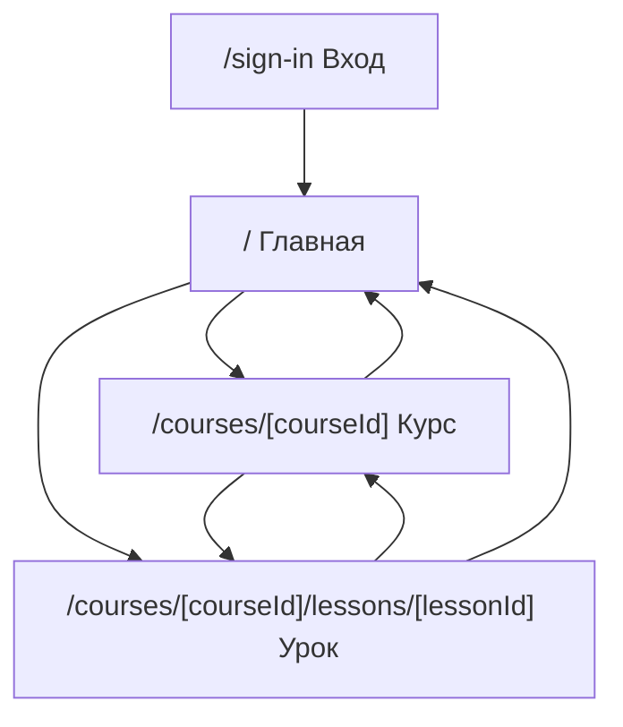

# Information architecture: learner journey

Issue #50 (PR #67), architect phase. "research §n" cites the #50 research notes; "the #50 design notes"
(decisions An, Dn, Pn and sections §n) cites the #50 design. Both are working notes, kept on the author's
machine and not published.

Several courses (#218, built by #220): section "Several courses (#218)" below, which says which rules
of this file it replaces from #220. Error and focus states with several courses: see #222.

Notation: `F6` in backticks is the keyboard key; F6 without backticks is the flow "Open a lesson whose
prerequisites are not passed". R1-R7 are the interaction rules below; flows refer to them by id instead
of restating them. "The #69 design note" (`plans/69-check-panel-detail-design.md`) and Stepan's decisions
for #69 (B0, S1-S12) are working notes of #69, kept like the #50 ones; the dev requirements they name are
filed as a dev issue. The departures they approve are cited where they are stated: S7 (no "Повторить" for a
check run, Action labels), S8 (no other-tab reason, R1), S9 (the #34 requirements), S10 (no outcomes
change), S11 (a passed check that spends tokens is not re-run, `checks.md` "Run composition"), S12 (a passed
lesson whose counted checks all spend tokens has nothing to run, R1).

## Vocabulary

One term per concept, in docs and in UI copy. Sources: `course/`, `docs/learning-process.md`,
`packages/lesson-schema` (research §2).

| Concept | English (docs, ids) | Russian (UI) | Note |
|---------|---------------------|--------------|------|
| course | course | курс | from #220 named by its title ([A218-7](#A218-7)) |
| course block (#218) | course block | - | [A218-1](#A218-1); its readable and empty forms: "Rules (#218)" |
| Card course (#218) | Card course | - | [A218-2](#A218-2) |
| end Card | end Card | "Все доступные уроки пройдены"; from #220 also "Все доступные уроки завершены" | [A218-2](#A218-2) |
| next-lesson link (#218) | next-lesson link | "Следующий урок: <lesson title>" | [A218-4](#A218-4) |
| root error (#218) | root error | "Не удалось загрузить курсы" | "Rules (#218)" |
| other-courses list (#218) | other-courses list | "Другие курсы" | [A218-14](#A218-14) |
| module | module | модуль | |
| lesson | lesson | урок | never "занятие", never "класс" |
| theory | theory | теория | |
| task | task | задание | |
| working folder (the files) | working folder | рабочая папка | the files from `starter/`, kept in a volume |
| environment (the running container) | environment | окружение | decision A1 in the #50 design notes. `workspace` appears only as the `lesson.yaml` field name (and in the image name `academy-workspace` it holds); docs never call the container a "workspace" |
| check | check | проверка | |
| run (one press of "Проверить", or "Запустить" in the budget confirmation, over the checks of `checks.md` "Run composition") | run; saved as one attempt record (next row); the fields `runningAttemptId` and `latestFinishedAttempt` name runs only (`checks.md` "Baseline of a re-read") | проверка, as in "Идёт проверка" | never "запуск" in check copy; the verb "Запустить" is the dialog button (#69). The check bar and the check rows call the run "проверка"; the history and review copy calls its record "попытка" (next row) |
| attempt record (of a run or of a quiz send) | attempt: ADR-0007's attempt record (item 5 "Attempt scope"; item 5's "grading run" covers both kinds below and is not the row "run" above; these other senses of "run" in `design/flows/` are not this concept either: "First run" for a product with no progress yet (`progress.md` F18 Empty states and A72-2, `dashboard.md` Empty states, "first-run failure" in `auth.md`) and the GitHub Actions runs of `gh run list` (`progress.md` A72-1)), the record of one run or, from #36, of one answered quiz send, a **quiz attempt record** (one record holding the quiz check's one result, `progress.md` A72-17), which is never a run. Docs use this sense for "attempt" with no limit or counting word next to it: "an attempt", "attempt id", "attempt status", "attempt history", "recent attempts", "the cost of an attempt" (dashboard, learning-process §2), the F16 and F19 titles, R5; field `attemptId`; the history baseline `latestAttemptRecordId` (any kind, from #35, `progress.md` F19 Loading); not `runningAttemptId` and `latestFinishedAttempt`, which name runs only (row above). "Quiz attempt record" names a quiz send's record; "a quiz attempt" alone is the per-check sense (next row) | попытка, only in history and review copy: "История попыток", "Попыток пока нет. Нажмите "Проверить", когда будете готовы." (shown in v1 in the Проверки tab), "История попыток недоступна" (from #35, F19), "Ментор читает попытку" (D3) | one run over two checks is one record holding two check results (next row); one answered quiz send is one record holding one. A run total cost has its own label: the row "cost of one attempt record (#72)" |
| attempt (one check's result) | attempt in per-check compounds only: "attempt limit", "last attempt" / "last-attempt warning", "attempts left" / "remain" / "leaves one attempt", "counted" / "uncounted" / "failed attempt", "spends an attempt", "attempt counter", a quiz attempt (one sent quiz as one result of the quiz check, `quiz.md`; its record is a "quiz attempt record", row above); fields `attemptLimit`, `lastAttemptCount`, `failedCount`. These count one check's results (ADR-0007 `check_results` rows), never runs: `failedCount >= attemptLimit` compares counted failed results of that check | попытка, in every check-row, limit and quiz string: "Неудачных попыток: N", "Неудачных попыток: N из M", "Осталась 1 попытка", "Проверок на последней попытке: N", "..., попытка не засчитана" (three check statuses and status-line summary 4, where it says no result of the run counts), "Проверок с незасчитанной попыткой: N" (attempt summary note, #72), "Стоимость попытки: $N", "Проверка закрыта: попытки исчерпаны. ...", "Счётчики попыток не обнулятся." (reset dialog), "Попытка A из M", "Попытка A" (quiz) | the unit an attempt limit counts. Not this concept and not the run: sign-in attempts ("Слишком много попыток входа...", `auth.md`) and the reconnect tries `CHECK_STREAM_RECONNECT_ATTEMPTS` / `TERMINAL_RECONNECT_ATTEMPTS` (parameter names, no UI text). Course quotes ("Попытки и подсказки", "Квиз: не больше 3 попыток") are task.md text, rendered as written |
| attempt limit | attempt limit (one check's results, row above) | no word of its own: "из M" in the counter and "Осталась 1 попытка" (R7) | from #68 |
| closed check | closed | "Закрыта: не пройдено", "Проверка закрыта" | final: nothing reopens it (S2) |
| runner error (the platform could not grade) | runner error | "Сбой проверки" | ADR-0007 `error`; never "ошибка проверки", because "ошибка формата" is the learner's |
| cost of one check's result | cost | "Стоимость попытки" | per check row, from that check's latest result, never a run total; from #37 / #39. A run total has its own label: the row "cost of one attempt record (#72)" |
| tokens (what a rubric or hidden-task check spends from the learner's API key) | tokens | токены, as in "Эта проверка расходует токены:" | learning-process §2 "Agent checks ... spend tokens"; only in the budget confirmation (#69) |
| quiz | quiz | квиз | |
| quiz question | question | вопрос, only as "Вопрос I из Q" and in the quiz strings | the hint level "Вопрос" (row "hint") is another concept with the same word: it is a level name in the hint ladder in Проверки (F17, D3) and never carries a number, while the quiz word always does and shows only in the Квиз tab, so the two never stand in one panel (#70) |
| mentor | mentor | ментор | also the grader of a rubric check ("оценка ментора"); never called "агент" |
| agent | agent | агент | Claude Code (or another coding agent) the learner runs in the terminal, as in "Ключ API для агента не задан: агент в терминале не запустится..."; also the agent a hidden-task check runs on the learner's files, named only in check titles (data). Never the rubric grader (that is the mentor). Lesson type "оценка агента" keeps this meaning. Check copy names no agent: the budget confirmation names the spend, not the spender (#69) |
| mentor review | mentor review | разбор | from task.md "разбор с ментором"; the action is always "Разобрать с ментором" |
| hint | hint | подсказка; levels "Вопрос", "Направление", "Скелет", "Скажи прямо" | learning-process §3 |
| outcomes | outcomes | "Чему научитесь" | the schema field `outcomes` |
| prerequisites | prerequisites | "Сначала пройдите" | |
| terminal | terminal | терминал | |
| editor | editor | редактор | |
| lost connection | connection | соединение | "Соединение с терминалом потеряно", "Соединение с проверкой потеряно"; never "связь" |
| page region | region | "Верхняя панель", "Уведомления", "Урок", "Проверка", "Окружение" | the stops of the `F6` cycle, see Navigation model |
| attempt number (#72) | attempt number | "№ N" | the place of an attempt record among this user's attempts of this lesson, oldest = 1, by `attempts.started_at`, every attempt record numbered (runner errors and, from #36, quiz attempt records included, a running run too, so a number never changes); derived, not stored (`progress.md` F19.1, A72-10). Not "Попытка A" or "Попытка A из M", which number one check's results in the quiz header (`quiz.md`, set "quiz"); the two numbers never stand in one panel (`progress.md` A72-17) |
| summary of one attempt record (#72) | attempt summary | the set "attempt summary" below | what one record's results add up to; never the check bar's lesson count "Пройдено: N из M" (`progress.md`, "Words") |
| cost of one attempt record (#72) | attempt cost | "Потрачено: $N" (set "cost" below) | the run total for which #69's row "cost of one check's result" asks a label of its own; this row is that label; never "Стоимость попытки", which is one check's result (#69). Summed by ADR-0007 item 11 |
| total cost (#72) | total cost | "Потрачено на проверки и разборы: $N" (set "cost" below) | names what it sums: checks and mentor reviews; the terminal agent's spend is not in it (ADR-0007 item 11) |
| checks where the learner struggles (#72) | weak checks | "Где трудно" | derived from failed and closed checks (Stepan, #72 architect brief, O1); never "слабые темы" or any "темы": no source tags a topic (#72 research §1.4). Replaces the #50 strings "Слабые темы", "Слабых тем пока нет" |

### Closed status sets

Every status the UI shows comes from exactly one of these sets. A set holds base labels plus named
variants; a variant is listed here verbatim (with `N`, `M`, `$N`, `<...>` as placeholders; the quiz set, the
quiz notice in the page alert set and the page copy row "lesson, quiz" also use `A`, `C`, `I`, `K`, `Q`, `U`,
one meaning each, `quiz.md` "Placeholders") or it does not exist. "When" says which release shows it: v1
(this PR's prototypes), or the deferred design that owns it (D1-D5 in the #50 design notes).

| Set | Labels (Russian, exact) | Where | When |
|-----|-------------------------|-------|------|
| lesson status (masculine, agrees with "урок") | "Не начат", "В процессе", "Пройден", "Не пройден" | catalog rows (F5.3), dashboard (F4, F18) | v1; "Не пройден" only once the server reports a lesson finished and not passed (the ADR-0007 amendment of the #69 design note; F14, R5, assumption A9). The lesson page never shows a lesson status; its check bar says "Урок пройден" or "Урок завершён: не пройден. Пройдено: N из M" from the same server status, and so does the quiz result block after a send that changes it (`quiz.md`, "Lesson outcome after a send") |
| module status (masculine, agrees with "модуль") | "Доступен", "Готовится" | catalog module list (F5.1), dashboard module rows (F18.2) | v1. "Доступен": has `ready` lessons; "Готовится": `planned`, or `ready` with no `ready` lesson |
| lesson type | "теория", "квиз", "артефакт", "оценка агента", "поиск багов", "проект" | lesson header (F7.1), dashboard card (F4.1), catalog rows (F5.3) | v1; the schema `type` values |
| check status (one check; neuter "пройдено" as in task.md) | base: "Не запускалась", "В очереди", "Идёт", "Пройдено", "Не пройдено", "Время вышло", "Ошибка формата, попытка не засчитана", "Сбой проверки, попытка не засчитана", "Закрыта: не пройдено"; variants: "Время вышло, попытка не засчитана", "Не пройдено: исчерпан бюджет $N" | check rows in Проверки (F13.3, F14.3), quiz check row (F15: only "Пройдено", "Не пройдено", "Закрыта: не пройдено"; `quiz.md`), attempt history panels (F19.2; a quiz result only "Пройдено" or "Не пройдено", `progress.md` A72-17), "Где трудно" rows (F18.4), "Закрыта: не пройдено" only | v1 (#34 with the ADR-0007 amendment); the budget variant from #39. The table in `checks.md` maps each to its token, icon, counting and release. "Не удалось запустить проверку" (#50) is replaced by "Сбой проверки, попытка не засчитана" (#69) |
| check row meta (collapsed row, after the status word) | running timer "M:SS из M:SS"; "лимит M:SS"; "Осталась 1 попытка" | collapsed check row (F13.3, F14.1) | v1 the timer and "лимит M:SS"; "Осталась 1 попытка" only with a known limit (R7, from #68). Each item only next to the status words of `checks.md` "Row meta by status word": the timer only with "Идёт", "лимит M:SS" only with the two "Время вышло" words, "Осталась 1 попытка" never with "Пройдено" or "Закрыта: не пройдено" |
| check row note (open row panel, in this order) | "Проверка закрыта: попытки исчерпаны. Сброс рабочей папки и перезапуск окружения её не откроют.", "Проверка уже засчитана. Последний результат: не пройдено", "Проверка уже засчитана. Последний результат: сбой проверки", "Стоимость попытки: $N", "Неудачных попыток: N", "Неудачных попыток: N из M" | open check row (F13.5, F14.3), "Где трудно" rows (F18.4), "Неудачных попыток: N" and "Неудачных попыток: N из M" only | v1 except "Стоимость попытки: $N" (from #37 / #39) and "из M" (R7, from #68). Which note shows with which status word: `checks.md` "Open panel by status word". In the sticky-pass note "не пройдено" is a group word for every latest result that is not a pass and not a runner error (failed, budget spent, timeout counted or not, format error); "сбой проверки" is the runner error |
| check bar status line (summary, then notes joined with ". ") | summaries: "Идёт проверка", "Соединение с проверкой потеряно. Переподключаемся...", "Не удалось получить результат проверки", "Сбой проверки, попытка не засчитана", "Урок пройден", "Урок завершён: не пройден. Пройдено: N из M", "Пройдено: N из M"; notes after "Пройдено: N из M" only: "Закрытых проверок: N", "Осталась 1 попытка", "Проверок на последней попытке: N", "Проверок со сбоем: N" | check bar (F13, F14); empty on load except in the nothing-to-run state (S3, or a passed lesson whose counted checks all spend tokens, `checks.md` "Run composition"), and emptied silently by a quiz send that makes its text untrue or leaves nothing to run (`quiz.md`, P7, P8) | v1; the two last-attempt notes only with a known limit (R7). Composition and order: `checks.md` "Check bar status line" |
| disabled reason (R1 description, never a status line) | "Окружение запускается, проверка станет доступна после запуска", "Сначала запустите окружение", "Дождитесь окончания проверки", "Результат проверки ещё не получен", "Проверки завершены", "Доступно, когда окружение работает", "Откроется, когда проверка будет закрыта" | "Проверить" (F13, F14), "Действия" items (F11), hint levels (F17) | v1 except the hint lock (D3). "Проверка уже идёт в другой вкладке" (#50) is dropped: the UI cannot tell another tab's run from its own after a reload (#69) |
| check kind (hidden in v1; registered for later) | "команда", "квиз", "оценка ментора", "скрытая задача", "поиск багов" (`command`, `quiz`, `rubric`, `hidden-task`, `bug-hunt`) | check row, after the title | not shown in any release designed so far; showing it is its own DESIGN task once a lesson lists a second kind (#36 or #37), `checks.md` "Check kind" |
| environment status (status bar) | base: "Создаём окружение", "Запускаем окружение", "Окружение работает", "Окружение остановлено. Файлы в рабочей папке сохранены. Запущенные процессы завершены."; variants: "Окружение остановлено: превышен лимит <памяти \| процессов \| CPU>. Файлы сохранены.", "Docker не запущен. Запустите Docker Desktop и нажмите "Повторить".", "Нет образа окружения academy-workspace. Соберите его (см. README) и нажмите "Повторить".", "Нет доступа к этому окружению."; appended notes: "Запуск идёт дольше обычного", "Рабочая папка сброшена", "Рабочая папка не найдена, создано новое окружение из исходных файлов урока.", "Ключ API для агента не задан: агент в терминале не запустится. Добавьте ключ в .env и перезапустите платформу." | environment status bar (F8, F10, F11) | v1 |
| terminal connection (status bar) | "Соединение с терминалом потеряно. Переподключаемся...", "Не удалось переподключиться", "Сеанс терминала завершён" | environment status bar (F9) | v1 |
| one-pane switch suffix | "остановлено", "ошибка" (appended to the accessible name of the tab "Окружение") | the switch "Урок / Окружение" (A8) | v1 |
| page alert (region "Уведомления") | "Сессия закончилась. Файлы в рабочей папке сохранены.", "Окружение остановится через N мин без активности. Файлы сохранятся."; quiz notice (P9, from #36), exactly these and no other combination (`quiz.md`, "Quiz notice (P9)", rows 1-11): "Ответы квиза проверены. Верно C из Q. Нужно K.", "Ответы квиза проверены. Верно C из Q. Нужно K. Осталась 1 попытка.", "Квиз пройден.", "Квиз пройден. Урок пройден.", "Квиз пройден. Урок завершён: не пройден. Пройдено: N из M.", "Квиз не пройден: попытки исчерпаны.", "Квиз не пройден: попытки исчерпаны. Урок завершён: не пройден. Пройдено: N из M.", "Ответы квиза не отправлены. Попробуйте снова.", "Ответы квиза не приняты: квиз изменился в другой вкладке." | every page with the top bar (F2.1), lesson (F10.1; the quiz notice, F15) | v1; the quiz notice D2, after #36 |
| quiz (D2; designed in #70) | "Нужно K из Q", "Попытка A из M", "Попытка A" (limit unknown, R7), "Верно C из Q. Нужно K.", "Верно C из Q.", "Квиз пройден", "Квиз не пройден: попытки исчерпаны", "Ответы не отправлялись" (quiz check row, in place of "Не запускалась"), question verdicts "Верно" / "Неверно" and option marks "Ваш ответ" / "Верный ответ" (review), "Ответьте на все вопросы: осталось U", "Ответы не отправлены. Попробуйте снова.", "Не удалось загрузить квиз" (the load error's title, an h3 under the panel heading, R2 page-level retry table; also the one text of the quiz load status container, R2), refusal result block (a send refused because the quiz changed in another browser tab): title "Ответы не приняты: квиз изменился в другой вкладке." and, while the quiz is open, "Последний результат: Верно C из Q. Нужно K." | Квиз tab (F15); from #35 "Верно C из Q." alone also in an open attempt of the history (F19.2, a quiz result, `progress.md` A72-17); the quiz check row in Проверки, which otherwise uses the check status set ("Пройдено", "Не пройдено", "Закрыта: не пройдено"), the check row meta set ("Осталась 1 попытка", also in the quiz header) and the check row note set ("Неудачных попыток: N", "Неудачных попыток: N из M") | D2, after #36; "из M" and "Осталась 1 попытка" only with a known limit (R7, from #68). Q, K, C, A and M come from the server (`quiz.md`, Stepan's decision P2); the letters: `quiz.md` "Placeholders". "Нужно N%", "Результат: N%. Нужно N%." and "Несколько вариантов" (#50) are replaced (#70) |
| mentor (D3) | "Ментор читает попытку", "до $N", "Оценка N из M, нужно N", "Стоимость разбора: $N", "Разбор готов", "Бюджет на разбор исчерпан", "Ментор не ответил", "Ключ API для ментора не задан: разбор недоступен.", "Ментор не видел транскрипт работы с агентом" | review block and hint ladder in Проверки (F16, F17) | D3, after #37; the key-missing sentence names no key, file or action until #37 decides them (FU16) |
| budget confirmation (AlertDialog) | title "Потратить до $N с вашего ключа API?"; description "Эта проверка расходует токены:" (one listed check) or "Эти проверки расходуют токены:" (two or more); list item "<check title>: до $N"; buttons "Отмена", "Запустить" | budget confirmation (F13.1) | from #37 / #39; lists only checks the run includes, never a passed one (S11). "Проверка с агентом потратит до $N" (#50) is replaced (#69) |
| editor (D5) | "Загружаем редактор", "Редактор не отвечает" | Редактор tab (F12) | D5, after #40 |
| attempt summary (one attempt record, #72) | summaries, the first that matches: "Идёт проверка" (status `running`; #69's run word, check bar summary 1), "Сбой проверки, попытка не засчитана" (the attempt has no check result, or every result is a runner error, as the check bar's summary 4 in `checks.md`, #69), "Пройдено проверок: N из M" (otherwise; M results in this attempt, N of them with the word "Пройдено"); one note after "Пройдено проверок: N из M" only, joined with ". ": "Проверок с незасчитанной попыткой: N" (N is the count K, at least 1: the results of this attempt whose own word, set "check status", contains "попытка не засчитана": "Время вышло, попытка не засчитана", "Ошибка формата, попытка не засчитана", "Сбой проверки, попытка не засчитана"; no other result, whatever its counting flag, so K always equals the number of such words in the attempt's panel). #69's "Проверок со сбоем: N" is not an attempt-row note (a runner error is one of the K). Each result kind and how it enters: `progress.md` A72-6; icon of each form: A72-8 | "Последние попытки" rows (F18.3), "История попыток" rows and plain items (F19.1) | from #35 (`progress.md`, A72-6). "Идёт проверка" shows only on the dashboard, with the `running` ring held still (the dashboard row is a snapshot): the history lists finished attempts (A72-9) |
| cost (#72) | attempt: "Потрачено: $N", "Потрачено: не меньше $N", "Потрачено: нет данных"; total: "Потрачено на проверки и разборы: $N", "Потрачено на проверки и разборы: не меньше $N", "Потрачено на проверки и разборы: нет данных" | attempt rows (F18.3, F19.1, only for an attempt that can spend), dashboard total (F18.5) | from #37 (Stepan, #72 architect brief, O3). Which variant: ADR-0007 item 11 ("Known or at least"); money format as `checks.md` "Money" (two decimals, a dot, rounded up) |

### Page copy

Messages, headings and notes that are not statuses, by page. The same closure holds: a flow quotes UI
text only from this list or from the two tables above and below. Quotes of course files (task.md, such as
"скелет" or "Сброс урока или рабочей папки счётчик не обнуляет") are sources, not UI text.

| Page | Copy (Russian, exact) |
|------|----------------------|
| sign-in (F1, F3) | "Вход" (`<title>` and h1), field labels "Почта" and "Пароль", "Входим..." (busy label of "Войти"), "Неверная почта или пароль", "Не удалось связаться с сервером. Проверьте, что платформа запущена (docker compose up), и попробуйте снова.", "Введите почту", "Введите пароль", "Слишком много попыток входа. Подождите и попробуйте снова.", "Пользователя создаёт скрипт seed, см. README", "Вы вышли" |
| dashboard (F4, F18, F20) | "Следующий урок", "около N мин", "Не удалось загрузить курс" (the course error's title, an h2 in the Card's place, R2 page-level retry table), "Прогресс недоступен, показан первый урок", "Все доступные уроки пройдены", "Новые модули появятся в каталоге", "В курсе пока нет готовых уроков", "Пройдено уроков: N из M", "N из M уроков", "N из M", "Пока нет пройденных уроков", "Прогресс недоступен"; from #220 (#218): "Все доступные уроки завершены", "Не удалось загрузить курсы", "Следующий урок: <lesson title>", the course name (data); error copy with several courses: see #222; F18.3-F18.5: the row "dashboard, progress (#72)" |
| dashboard, progress (#72) | F18.3 (from #35): section h2 "Последние попытки" (also the name of its `ul`, `aria-labelledby`), the empty text "Попыток пока нет"; each row one link whose name is its fields joined by ". " (`progress.md` A72-19): lesson title (data), date and time (data, format below), the attempt summary (set "attempt summary"), from #37 the attempt cost (set "cost"), for example "Закрытый контур. 3 ноября, 18:40. Пройдено проверок: 1 из 1". F18.4 (from #35): section h2 "Где трудно" (also the name of its `ul`), the empty text "Пока нет проверок, которые не удаются"; each row one link whose name is its fields joined by ". ": check title (data), lesson title (data), and "Закрыта: не пройдено" (set "check status") or "Неудачных попыток: N" / "Неудачных попыток: N из M" (set "check row note", one check's results). An empty section holds its empty text in place of the `ul`. F18.5 (from #37): h2 the total (set "cost"), the note "Расход агента в терминале сюда не входит"; its `section` has no accessible name (`progress.md` F18 keyboard path). Date and time format (both pages): day, month name in the genitive, hours and minutes in the learner's local time, "4 ноября, 14:05"; the year after the month when it is not the current year, "4 ноября 2025, 14:05"; in `<time datetime="<ISO 8601>">`. The #50 strings "Слабые темы" and "Слабых тем пока нет" are dropped (vocabulary, "checks where the learner struggles") |
| lesson, attempt history (F19; #72) | from #35, below the check list of the Проверки tab: section h3 "История попыток" (also the name of its `ul`); in the error state the h3 reads "История попыток недоступна" with "Повторить", and when the re-read started by the first attempt record (the first run's end, the first answered quiz send, or a visibility re-read that finds a record this page has not shown: sent in another browser tab, or this page's own timed-out send the server recorded) fails the same text is written once into the visually hidden history status container (R2, `progress.md` F19 error states); the empty text "Попыток пока нет. Нажмите "Проверить", когда будете готовы." (in place of the `ul`), and "Попыток пока нет" alone from the moment the first run disables "Проверить" ("Дождитесь окончания проверки", "Результат проверки ещё не получен") until the history re-read after that run returns, and in place of the long text on a lesson whose check bar has no "Проверить" (a quiz-only lesson, from #36, not drawn) (`progress.md` F19 empty states); each attempt row a disclosure button whose name is its fields joined by ". " (`progress.md` A72-19): "№ N" (vocabulary, "attempt number"), date and time (format in the row above), the attempt summary, from #37 the attempt cost, for example "№ 3. 4 ноября, 14:05. Пройдено проверок: 1 из 2. Проверок с незасчитанной попыткой: 1"; an attempt with no check result a plain list item (`li`, `tabindex="-1"`, not a button) whose text holds the same fields, joins and order and the summary "Сбой проверки, попытка не засчитана", for example "№ 2. 4 ноября, 13:50. Сбой проверки, попытка не засчитана"; in an open panel per result: check title (data) or check id (data) with "Этой проверки больше нет в уроке", the result's status word (set "check status", result words only, `progress.md` F19.2), the grader message (data), for a quiz result "Верно C из Q." (set "quiz") in its place, "Подробности" with the raw error (data), from #37 / #39 "Стоимость попытки: $N" (set "check row note", #69), from #37 the review block (set "mentor"). The panel's list has no name of its own; the section has none either (no `region` landmark inside "Урок", `progress.md` F19 keyboard path). The three strings "История попыток", "Попыток пока нет. ..." and "История попыток недоступна" are also in the row "lesson (F6-F13, F19)" below, marked "(from #35, F19)" there |
| catalog (F5, F6) | "Не удалось загрузить курс" (the course error's title, the page h1, R2 page-level retry table), "Прогресс недоступен", "Уроки модуля готовятся", "Сначала пройдите: <lesson title>"; from #220 (#218) "Другие курсы" and its links (data) |
| not-found (F5, F7) | "Страница не найдена" (`<title>` and h1), "Возможно, в адресе опечатка или ссылка устарела." (the one sentence under the h1, in every state), and the action "Открыть курс" (only while the course id is known, R6 "Course id unknown"; from #220 [A218-12](#A218-12)). No other text in `main`: no "404", no breadcrumb, no search |
| lesson tabs | left pane "Теория", "Задание", "Проверки", "Квиз" (D2); environment "Терминал", "Редактор" (D5); one-pane switch "Урок", "Окружение" |
| lesson (F6-F13, F19) | "Не удалось загрузить курс" (`<title>` and h1 when the course cannot be read, F7 error states), "около N мин", "Чему научитесь", "Содержание", "Источники", "проверено <date>", "Не удалось загрузить текст урока" (the text load error's title, an h2 in the tab panel, R2 page-level retry table), "Не скопировано, выделите текст вручную", "Блок кода" (accessible name of a Теория, Задание or quiz explanation code block that overflows and so takes Tab, #136; `lesson-environment.md` "Code blocks that scroll"), "Окружение и проверки появятся в следующей версии платформы" (M0 lesson only), the key hint "`F6` или Ctrl+Shift+. (клавиша Ю): следующая область" (macOS: "`F6` (Fn+`F6`) или Ctrl+Shift+. (клавиша Ю): следующая область"), the split handle's accessible name "Граница панелей" and its tooltip "Перетащите или щёлкните, чтобы сменить ширину" (F9.3), the reset dialog "Сбросить рабочую папку?" with "Файлы урока вернутся к исходным, ваши изменения пропадут. Счётчики попыток не обнулятся.", the tab name "Проверки, идёт проверка" (visually hidden part during a run), "История попыток", "Попыток пока нет. Нажмите "Проверить", когда будете готовы.", "История попыток недоступна" (from #35, F19). The Задание tab renders task.md's own headings ("Что в рабочей папке", "Что сделать", "Что значит "готово"", "Как проверяется", "Попытки и подсказки") as written |
| lesson, accessible names (#69) | "Навигация" (breadcrumb `nav` label), "Область" (one-pane switch tab list label), "Разделы урока" (left-pane tab list label), "Окружение" (environment tab list label), "Терминал" (terminal frame name), the visually hidden region headings "Урок", "Проверка", "Окружение", "Уведомления" (the page region row of the vocabulary). The user menu is named by its trigger, the email (data, not copy) |
| lesson, checks (F13, F14; #69) | the Проверки tab panel heading "Проверки"; the tab's visually hidden running part ", идёт проверка"; every check status, row meta, row note, status line text, disabled reason and the budget confirmation copy are in the closed sets above, and every button in Action labels. Grader messages and raw errors under "Подробности" are data, shown verbatim, not copy |
| lesson, quiz (F15; #70, from #36) | the tab label "Квиз" with no state suffix (unlike "Проверки, идёт проверка", nothing in the quiz changes while the learner is on another tab); the panel heading is the quiz check `title` (data); the question heading "Вопрос I из Q", which is also the accessible name of its radio group or checkbox group (the prompt is the group's description); "Код к вопросу" (accessible name of a prompt's code block that overflows and so takes Tab); "Засчитывается только точный набор ответов" (note under every `multiple` prompt); per-question errors "Выберите ответ" (`single`) and "Выберите хотя бы один вариант" (`multiple`); error-summary links "Вопрос I из Q: выберите ответ" and "Вопрос I из Q: выберите хотя бы один вариант"; "Отправляем..." (busy label of "Отправить ответы"); result descriptions "Ответы остались выбранными. Какие из них неверны, квиз покажет после прохождения или после последней попытки." (limit known), "Ответы остались выбранными. Какие из них неверны, квиз покажет после прохождения." (limit unknown), never after a refused send, and "Ниже верные ответы и пояснения." (pass, close, and a refusal that finds the quiz passed or closed); the explanation heading "Пояснение"; a fenced block in an explanation that overflows is named "Блок кода" (the row "lesson (F6-F13, F19)"; #136), not "Код к вопросу"; the result block's lesson line reuses the check bar's "Урок пройден" (from #69 also "Урок завершён: не пройден. Пройдено: N из M"). Prompts, options and explanations, including "Выберите все верные.", are quiz content (data), not copy |

### Action labels

One Russian label per action. A button with the same job has the same label on every page. "v1" says
whether the control is shown in v1; a hidden control appears only when its issue ships (rule R6).

| Action | Label | Flows | v1 |
|--------|-------|-------|----|
| skip to the content | "К содержимому" | every page | yes |
| open the dashboard (top bar) | "Академия" (brand link), "Главная" (nav link) | F4; from #220 F20, F22 | yes, every page with the top bar |
| open the catalog (top bar, lesson breadcrumb) | "Курс" | F5 | yes, from #30 (R6, "Before the catalog ships"); not while the course id is unknown (R6, "Course id unknown"); until #220 |
| open a course's catalog (block heading, course crumb, "Другие курсы" link) | the course name (data) | F20, F22, F5 | from #220 (#218) |
| open a course's next lesson (course block) | "Следующий урок: <lesson title>" | F20 | from #220 ([A218-4](#A218-4)) |
| sign in | "Войти" | F1 | yes |
| sign in again after expiry | "Войти снова" | F2 | yes |
| sign out | "Выйти" | F3 | yes |
| open the next lesson | "Начать" (lesson not started, R5) / "Продолжить" (started) | F4 | yes |
| open the catalog | "Открыть курс" | F4, F5, F7, F8; from #220 F20, F22 | yes, from #30 (R6, "Before the catalog ships"); on the not-found page not while the course id is unknown (R6, "Course id unknown"); from #220 [A218-12](#A218-12) |
| retry a failed load or start | "Повторить" | F1, F4, F5, F7, F8, F15, F16, F18, F19 | yes where its flow is v1 (F1, F4, F5, F7, F8, F18); F15 D2; F16 D3; F19 from #35. A check run is retried with "Проверить", never "Повторить" (#69, S7, `checks.md` F13 error states) |
| expand / collapse the outcomes | "Показать все" / "Свернуть" | F7 | yes |
| copy a code block | "Копировать" | F7 | yes |
| start a stopped environment | "Запустить снова" | F8, F10 | yes |
| keep the environment alive | "Продолжить работу" | F10 | yes |
| open the environment actions | "Действия" | F11 | yes |
| restart the environment | "Перезапустить окружение" | F11 | yes |
| reset the files | "Сбросить рабочую папку"; dialog buttons "Сбросить" / "Отмена" | F11 | yes |
| toggle the terminal screen reader mode | "Режим для экранного диктора" (a checkbox item in "Действия") | F9, F11 | yes |
| reconnect the terminal | "Переподключиться"; new shell "Открыть новый сеанс" | F9 | yes |
| reconnect to the check result stream | "Переподключиться" (the same label: the same job on another stream; like the terminal's, it starts a new reconnect cycle) | F13 | yes |
| show raw error details | "Подробности" | F8, F13, F19 | yes (F13: inside an open runner-error row); F19 from #35, inside an open attempt panel |
| run the checks | "Проверить" | F13 | yes |
| open the results | "Открыть результаты" | F13 | yes |
| move focus to the environment | "К окружению" | F13 | yes |
| confirm a run that spends tokens | "Запустить" / "Отмена" (budget confirmation) | F13 | no, from #37 / #39 |
| take the quiz | "Пройти квиз"; send "Отправить ответы" | F13, F15 | no, D2 (#36) |
| open the quiz outcome from the quiz notice | "Открыть квиз" | F15 | no, D2 (#36) |
| ask for a review | "Разобрать с ментором"; reply "Ответить" | F13, F14, F15, F16 | no, D3 (#37) |
| ask for a hint | "Попросить подсказку"; next level "Следующая подсказка" | F13, F17 | no, D3 (#37) |
| reload the editor | "Перезагрузить редактор" | F12 | no, D5 (#40) |

## Interaction rules

Each rule is stated once here. A flow that has a case of it names the rule and adds only its own data
(which control, which reason).

### R1: disabled actions with a reason

A control that cannot act now but will act later stays in its place and stays focusable:
`aria-disabled="true"` (never the native `disabled` attribute, which removes it from the Tab order), and
activating it does nothing. Its reason is visible text next to it (`muted-foreground`), tied to it with
`aria-describedby`, so Tab reaches the control and a screen reader reads why. The reason is never put in a
status line or a live region: a status line reports what happened, not what is blocked. The reason texts
are the "disabled reason" set above. Every disabled control in v1:

| Control | When | Reason | Also offered |
|---------|------|--------|--------------|
| "Проверить" (F13) | the environment is being created or started (F8.1) | "Окружение запускается, проверка станет доступна после запуска" | - |
| "Проверить" (F13) | the environment is stopped or failed to start (F8 errors, F10.3) | "Сначала запустите окружение" | "К окружению", right after it in the Tab order; then "Открыть результаты" if a run ended on this page (F13.4) |
| "Проверить" (F13) | a run of this lesson is going, started in this tab, another tab or before a reload, or its result stream is reconnecting, automatically or after "Переподключиться" (F13.2, F13 error states) | "Дождитесь окончания проверки" | "Открыть результаты" only after the run |
| "Проверить" (F13) | reconnecting the result stream failed (F13 error states) | "Результат проверки ещё не получен" | "Переподключиться", right after it in the Tab order |
| "Проверить" (F13, F14) | nothing to run (`checks.md` "Run composition"): every counted check is passed or closed and at least one is closed (S3, F14.4); or, from #37 / #39, the lesson is passed and every counted check spends tokens (S12, following from S11) | "Проверки завершены" | "Открыть результаты", from page load |
| "Перезапустить окружение", "Сбросить рабочую папку" (F11) | a run is going, once this page knows of it (its own run, or attached after a refusal, F11 error states) | "Дождитесь окончания проверки" | - |
| "Перезапустить окружение", "Сбросить рабочую папку" (F11) | the environment is not running (creating, starting, stopped, an F8 error) | "Доступно, когда окружение работает" | the status bar's own action ("Повторить", "Запустить снова") |
| "Войти" (F1.3) | the form is being sent | none: the busy label "Входим..." replaces the label and is the reason | - |

One reason at a time, in this order: "Дождитесь окончания проверки", "Результат проверки ещё не получен",
"Проверки завершены", then the environment reasons. While a run is going, "Дождитесь окончания проверки"
wins over every environment reason, on "Проверить" and on the "Действия" items, because the run is the next
thing to end and the learner can do nothing until it does; when it ends (with a result, or a runner error
if the environment stopped under it), the next row that holds applies. "Проверки завершены" wins over the
environment reasons, and "К окружению" is not offered with it, because starting the environment would not
enable "Проверить".

"Проверки завершены" is the one R1 case that never acts later while the lesson's checks stay as they are:
a closed check never reopens (S2) and a passed check that spends tokens is not re-run (S11). It stays an
`aria-disabled` control in its place, by Stepan's decision S3, so the check bar, the `F6` landing (R3) and
the Tab order are the same in every state, and its reason says why nothing runs. The reason "Проверка уже
идёт в другой вкладке" (#50) is dropped (S8).

Deferred cases follow the same rule: locked hint levels with "Откроется, когда проверка будет закрыта"
(D3). A menu item in "Действия" carries its reason as a second line inside the item, with the same
`aria-describedby`.

### R2: live regions

- Every live container exists in the DOM from page load (the history and quiz load status containers from
  the moment their section or tab panel is rendered, below); its text is inserted and replaced, never
  inserted together with the container, because a live region added with its content is not reliably
  announced; a container that enters the accessibility tree with its tab panel waits a minimum age before
  its first text (the quiz load status container, `QUIZ_LOAD_STATUS_MIN_AGE_MS`, below; the history status
  container, FU15). It is empty on load, with one exception: the check bar status line in the nothing-to-run
  state (S3, `checks.md` "Run composition") is rendered with its text as part of the page, so that text is
  not announced on load (next bullet); it is still never inserted together with the container. Two
  consecutive texts of the check status line, the empty one of an equal-string re-set included, are at
  least `CHECK_STATUS_TEXT_GAP_MS` apart (`checks.md` "Live regions", text gap), so each is announced.
  Each carries an explicit `aria-live` matching its role (`polite` with `role="status"`, `assertive`
  with `role="alert"`), because an open modal menu or dialog (Radix, `hideOthers` of `aria-hidden` 1.2.6) puts
  `aria-hidden` on the rest of the page and spares only `[aria-live]` nodes and their ancestors (`quiz.md`
  "Away"; FU11). The container is the only live element: a component inside it drops its own live role (the
  app's `Alert` renders `role="alert"` by default, `ui/alert.tsx:36`, and takes `role={undefined}` there, as
  `notifications.tsx:57-58` does for F2.1), so nothing is announced twice or with another politeness.
- Live containers on the lesson page whose course was read, and nothing else: the environment status text
  (`role="status"`), the check bar status line (`role="status"`, empty on load except in the nothing-to-run
  state; which changes are announced and which are rendered silently, by one rule: `checks.md` "Live
  regions"), and in region "Уведомления" one `role="alert"` container (F2.1) and one `role="status"`
  container (F10.1); from #36, on a lesson with a quiz check, a second `role="status"` container after
  them for the quiz notice (F15, `quiz.md` "Quiz notice (P9)"), used only for a send answered while the
  learner is away: the Квиз panel is not shown, or focus is in the region "Окружение" (R3), in a menu or
  dialog opened from it, on the split handle, in the region "Уведомления", or in an open menu or modal
  dialog anywhere on the page (`quiz.md` "Away" classifies every focusable place). From #35 (#72), on a
  lesson page that shows the Проверки tab, the attempt history's status container (`role="status"`,
  visually hidden, inside the F19 section), present and empty whenever the section is rendered, before any
  text is set. One case only writes it, once, with "История попыток недоступна": a history re-read that a
  new attempt record starts (a run's end, an answered quiz send, or a visibility re-read that finds a record
  this page has not read, `progress.md` F19 Loading) fails while the history was empty and the Проверки tab
  panel is shown (`progress.md` F19 error states), set no sooner than `CHECK_STATUS_TEXT_GAP_MS` after the
  check bar's end text, or, after a quiz send, after the quiz notice text when one was set (the notice is
  set only when the answer arrived while the learner was away, `quiz.md` "Away"; a learner who saw the
  result block and then opened Проверки before the re-read failed has no notice, and the gap then waits for
  nothing); "Повторить" loading the history empties it.
  Not the "Уведомления" status container, because a history error there would make "Уведомления" a
  landmark and an `F6` stop for a message that belongs to one tab panel; not the check bar status line,
  because its text is the run's outcome (`checks.md` "Live regions") and the history error would replace
  it. From #36 (#99), on a lesson with a quiz check, the quiz load status container (`role="status"`,
  visually hidden, inside the Квиз tab panel right after its heading), present and empty whenever the panel
  is rendered, from the moment a load starts, before any text is set. One case only writes it, once per
  failed load, with "Не удалось загрузить квиз": a quiz load (the first, or "Повторить") fails while the
  Квиз panel is shown and no focus move announces it (the first load always; a "Повторить" when focus has
  left the panel and is not on `body`, the retry focus guard below), because the error then replaces the
  Skeletons in view, a status message (WCAG 4.1.3); set after the panel's `aria-busy` is removed and no
  sooner than `CHECK_STATUS_TEXT_GAP_MS` after the check bar status line's last text when that text is
  younger than the gap (after that text when it still waits for its own gap), as for the history status
  container, and no sooner than `QUIZ_LOAD_STATUS_MIN_AGE_MS` (100 ms, React Aria's live announcer delay for
  Safari, `quiz.md` "The quiz load status container") after the container entered the accessibility tree,
  because Radix may unmount the inactive Квиз panel, so a first load from the Квиз tab mounts the container
  as the load starts; the write waits for the latest of the three (for a "Повторить" the container has
  been in the tree since the panel was shown, so the age has normally passed); never written with the panel not shown (nothing becomes visible) or when the h3 takes focus
  (nothing said twice); emptied, silently, when a load starts, which also drops a write still waiting (the error it would announce is gone), so every failure is announced again
  (`quiz.md` "Loading"). It never meets the history status container, because each is written only while
  its own left-pane tab panel is shown. Not the quiz notice, for the reason given for the history error
  (a landmark and `F6` stop for a message of one tab panel) and because the notice is P9's channel for a
  send. D3 adds the review's `role="status"` ("Разбор готов"). Other pages with the top bar, and the lesson
  page whose course cannot be read (no "Проверка" or "Окружение" region exists then, R3): the
  "Уведомления" containers only.
  Sign-in has no live container: every error after "Войти" moves focus to its message, and a submit with
  an empty field moves focus to the first empty field (`auth.md` F1, keyboard path), so a screen reader
  reads the error at the focus point.
- Every elapsed-time display is outside every live container and is not announced: a standalone one
  (the check bar timer) is `role="timer"`; one inside a button (a check row's running time) is part of the
  button's name, because a button's children are presentational and a role there is dropped (`checks.md`
  "Check row fields").
- "Уведомления" is a wrapper that always holds all its containers. It becomes a `region` landmark with a
  visually hidden heading "Уведомления" only while a container holds text, and drops both when they are
  empty; the containers themselves are never removed. An empty wrapper is no landmark and no `F6` stop.
- **Focus after a background change** (the one rule; every flow points here). When a change the learner did not
  make on the focused element (a quiz send's answer, a run's end or a check's result, a re-read when the
  browser tab becomes visible, attaching to a running run, a stream drop or reconnect, the environment
  stopping or starting, the S3 state found later, an idle stop)
  removes the element that holds focus, hides it or makes it unfocusable, focus moves, never to `body`, to the
  first that applies for the place the element was in:
  1. the Квиз panel: the quiz result block, or the send error after a failed send (`quiz.md`); the focus move
     into the panel also removes the quiz notice;
  2. an open check row panel in Проверки ("Пройти квиз" after a pass or close, "Подробности"): that row's own
     disclosure button, which is never removed (the rows are the lesson's counted checks);
  3. "Проверка" ("К окружению", "Переподключиться", "Открыть результаты"): its R3 landing as it now is,
     "Проверить", which R1 never removes;
  4. "Окружение": the R3 table row for its new state;
  5. "Уведомления": the idle warning removed by an idle stop with focus in it (F10.3): "Запустить снова" in
     the status bar, or the switch tab "Окружение" in one-pane mode with "Урок" shown (named here so the stop has
     one target, the control that undoes it); the F2.1 alert is never removed by a background change (only
     leaving the page removes it); the quiz notice removed with focus in it: its own rule below (the
     "Открыть квиз" target), and a later away-answer only replaces its title text, keeping the Alert and
     "Открыть квиз", so focus stays (`quiz.md`, "Announced once, never twice");
  6. anywhere else: the R3 landing of the shown pane's region ("Урок", or "Окружение" in one-pane mode with
     it shown).
  An R1 `aria-disabled` control stays focusable, so focus stays on it and its new reason is read when it is
  next reached. A change that removes nothing focused moves no focus. When the budget confirmation closes
  because of such a change, focus moves to "Проверить" first and the status text is set after (#69's
  `checks.md` B6, B23), because the page behind an open modal is inert. Every such transition of the checks
  is listed with its focus target in `checks.md` "Background changes and focus" (B1-B26). The same order
  resolves a return target that is gone (next bullet).
- Focus when a focused alert disappears: after "Продолжить работу" (F10.2) focus returns to the element
  that had it before focus entered "Уведомления", or, if there was none, to the R3 landing of the shown pane's
  region. If that element is gone or no longer focusable when the warning closes (an answer to a quiz send
  replaced the busy button or the options with the review; P8 removed "К окружению"), focus goes where the
  rule above sends it for the place the element was in. The page's other focus returns (a menu closing to its
  trigger, the reset dialog to "Действия", the budget confirmation to "Проверить") go to controls that are
  always rendered while the menu or dialog is open ("Действия" and the user menu button in every state,
  "Проверить" by R1). When the environment stops (F10.3) while focus is in the idle warning, focus moves
  as item 5 of the rule above says: "Запустить снова", or the switch tab "Окружение" in one-pane mode with
  "Урок" shown (its name then ends in "остановлено"). The F2.1 alert disappears only by leaving the page.
  The quiz notice disappears, silently, when the Квиз panel becomes shown, when focus or a pointer press
  moves into the shown panel, or when "Отправить ответы" starts a send; a later away-answer replaces it in
  the same container (only its title text, so focus on "Открыть квиз" stays). If focus is in it when it
  goes (read at `pointerdown`): a press on a focusable element in the panel (`tabindex="-1"` targets
  included) moves focus to that element by script ("Отправить ответы": the busy button); any other trigger
  moves focus to the quiz result block or send error ("Открыть квиз"'s target, `quiz.md` "Quiz notice
  (P9)").
- Focus when an activated control removes itself (R1 and R2 share this rule; R1 keeps a blocked control in
  place, so this is only about a control the new state replaces): a status-bar action ("Повторить",
  "Запустить снова", "Переподключиться", "Открыть новый сеанс") moves focus to what the R3 table names for
  the region's new state (for example "Действия" while starting); the check bar's "Переподключиться" (F13)
  moves focus to "Проверить", the R3 landing of "Проверка". A page-level "Повторить" moves focus to
  what replaced the block (`tabindex="-1"`, its heading when it has one), or, when the load fails again, to
  the error's own heading, and the `<title>` is the one of the page now shown. The target of each
  page-level retry, per outcome, under the retry focus guard below the table:

  | Retry | Loads | Fails again | Loads, but the URL is a way into the not-found page (page inventory, not-found Route) |
  |-------|-------|-------------|----------------------------------------------------------------|
  | dashboard course error | the Card heading "Следующий урок"; `<title>` "Главная" | the error heading "Не удалось загрузить курс" (h2, `tabindex="-1"`, the Alert title, in the Card's place); `<title>` "Главная" | - (the dashboard URL names no course) |
  | dashboard progress section | the section heading (the course line) | the section heading "Прогресс недоступен" | - |
  | every retry with several courses (from #220) | see #222 | see #222 | see #222 |
  | catalog course error | the course h1; `<title>` the course title | the error h1; `<title>` "Не удалось загрузить курс" | the not-found h1; `<title>` "Страница не найдена" |
  | lesson course error | the lesson h1; `<title>` the lesson title | the error h1; `<title>` "Не удалось загрузить курс" | the not-found h1; `<title>` "Страница не найдена" |
  | lesson text load error | the reloaded tab panel; `<title>` unchanged | the error heading "Не удалось загрузить текст урока" (h2, `tabindex="-1"`, the Alert title, in the tab panel); `<title>` unchanged | - (the course was read) |
  | lesson attempt history (F19, from #35; #72) | the history heading "История попыток" (h3, `tabindex="-1"`); `<title>` unchanged | the error heading "История попыток недоступна" (h3, `tabindex="-1"`) | - (the course was read) |
  | quiz load error (from #36) | the quiz panel heading (the check title); `<title>` unchanged | the error heading "Не удалось загрузить квиз" (h3, `tabindex="-1"`, the Alert title, under the panel heading); when the guard keeps focus where it is and the Квиз panel is shown, the quiz load status container says "Не удалось загрузить квиз" (list above, `quiz.md` "Loading"); `<title>` unchanged | - (the course was read) |

  The not-found h1 (`tabindex="-1"`) is the target in the last column because it is the heading of what
  replaced the block and it is read before "Открыть курс"; the not-found page reached any other way does not
  move focus. Every "Fails again" target is a heading with `tabindex="-1"` that names the error (in the
  course, text and quiz load errors the Alert title itself, in the catalog `#state-course-error`
  composition, `.alert-title` sized `text-sm`; in the progress and history rows the section heading), and
  never "Повторить" itself, because focus on an element that already has it fires no focus event (HTML focusing steps), so a screen
  reader would say nothing. The retry starts on "Повторить" (or, for the quiz, on the panel heading its
  loading state focuses) and ends on the heading, a different element, so the focus move is real and the
  heading is read with its level, also on a second, third or later failure whose text equals the first one's.
  A "Fails again" move needs no live container and no text gap, because no text is set; the one container a
  retry writes is the quiz load status container, for a quiz failure that the guard keeps from moving focus
  (list above). Pressing a page-level "Повторить" that stays rendered while its retry runs (every row except the
  quiz load error, whose loading state removes it) puts focus on it when the press did not, because a
  pointer press may not focus the button (Safari, MDN "Clicking and focus"), and the retry then starts on
  "Повторить" in every browser, so the "Fails again" move always goes to a different element. A `tabindex="-1"` heading is skipped by the `F6`
  landing (R3) and by Tab, so no landing and no Tab order changes; the next Tab from the heading reaches
  "Повторить".
  **Retry focus guard.** A retry's closing focus move (its "Loads" or "Fails again" target) is made only
  when focus is still on "Повторить", on `body`, or inside the block the retry belongs to, and the target is
  shown; otherwise focus stays where the learner put it. The block: the dashboard course error's Alert, the
  dashboard progress section, `main` for the catalog and lesson course errors, the text load error's tab
  panel, the F19 history section, and for the quiz the Квиз tab panel (its heading, which the loading state
  focuses, included). Because a learner who moved on before the answer must not be pulled back: two panes,
  "Повторить" pressed, then a click into the terminal; a Shift+Tab to the top bar or the Квиз tab, whose arrow
  keys then keep working; an open menu, whose focus trap (Radix `FocusScope`) would fight a script focus move
  or close the menu. A hidden target cannot take focus at all (HTML focusing steps), so a retry that ends
  with its tab panel or pane hidden makes no move either. Nothing new is owed when focus stays: in every row
  but the quiz the error stays rendered, unchanged, while its retry runs, so a failure changes nothing on
  screen, and in every row a load that succeeds is page content, not a message about it; the quiz load
  error's loading state replaces the error with Skeletons, so a failure there is visible again and the quiz
  load status container says it (list above). The guard covers the "Loads" and "Fails again" columns; the
  not-found column keeps its statement here and is #95's (FU1-FU4). Sign-in's "Повторить" sends the form, so focus moves to "Войти", which reads "Входим..." (R1
  row).
- Focus never falls back to `body`.

### R3: the `F6` cycle and where focus lands

This is the only statement of the region order; every flow refers to it. Decision A2 in the #50 design notes.

Regions on the lesson page whose course was read, each a `region` landmark with a heading (except
"Верхняя панель", the `banner`), in `F6` order (while the course cannot be read only "Верхняя панель",
"Уведомления" and `main` exist: the course-error row of the table below):

1. **"Верхняя панель"** (`banner`): "Академия", "Главная", "Курс" (not while the course id is unknown,
   R6), user menu.
2. **"Уведомления"**: only while it holds an alert (R2); skipped otherwise.
3. **"Урок"** (the left pane): in one-pane mode the switch "Урок / Окружение"; breadcrumbs, lesson header,
   prerequisite alert (F6.2), tabs Теория, Задание, Проверки (Квиз from #36, rule R6).
4. **"Проверка"** (the check bar): "Проверить" and its reason, then "К окружению" or "Переподключиться",
   and "Открыть результаты", when shown (in that order, R1; `checks.md` F13 keyboard path), the status
   line, the timer. Drawn under the left pane but a sibling of "Урок" in the DOM, not inside it.
5. **"Окружение"** (the right pane): in one-pane mode the switch "Урок / Окружение"; the status bar
   (status, status action, "Подробности", "Действия", the key hint), tabs Терминал (Редактор from #40).

After "Окружение" the cycle wraps to "Верхняя панель". A region that does not exist in a state (table
below) is no stop.

- `F6` moves focus to the next region, Shift+`F6` to the previous one, from anywhere on the page,
  including from inside the terminal. Fallback chord with the same effect: Ctrl+Shift+. (next) and
  Ctrl+Shift+, (previous), matched by `KeyboardEvent.code` (`Period`, `Comma`), so it works under the
  Russian layout, where these are the physical keys Ю and Б; Ctrl, not Cmd, on macOS too. Why this chord:
  `lesson-environment.md` F9, "Leave key decision".
- Focus lands on the region's first focusable element in DOM order. Every region in every state has one,
  because disabled actions stay focusable (R1):

| Region | State | `F6` lands on |
|--------|-------|---------------|
| Верхняя панель | every state | "Академия" |
| Уведомления | session expired (F2.1), alone or with the idle warning or the quiz notice | "Войти снова" (the alert container comes first in the wrapper) |
| Уведомления | idle warning (F10.1), alone or with the quiz notice | "Продолжить работу" |
| Уведомления | quiz notice only (F15, from #36) | "Открыть квиз" |
| Уведомления | empty | no stop |
| Урок | two panes (from 1024 px), or full width with no "Окружение" region (the M0 lesson, a lesson without the `workspace` field), every state in which the course was read | the breadcrumb "Курс" |
| Урок, Проверка, Окружение | the course cannot be read (F7 error states) | no stop: none of the three regions exists; `main` itself is the stop instead, as on the pages below, and lands on "Повторить" |
| Урок | one-pane mode (below 1024 px, only when "Окружение" exists), either pane shown | the switch tab "Урок" (`F6` shows the pane if it was hidden) |
| Проверка | every state of a lesson with checks the platform runs: before a run, running (own or attached), result stream reconnecting or failed, environment creating, starting, stopped or failed, after a run, nothing to run (S3; a passed lesson with only token-spending checks, S12) | "Проверить" (enabled, or `aria-disabled` with its reason, R1) |
| Проверка | the M0 lesson; a lesson with no check the platform runs (R6) | no stop: the region does not exist |
| Окружение | one-pane mode, either pane shown | the switch tab "Окружение" (`F6` shows the pane if it was hidden) |
| Окружение | two panes: creating, starting, slow start, running, reconnecting, API key warning | "Действия" |
| Окружение | two panes: Docker not running, image missing | "Повторить" |
| Окружение | two panes: stopped (F10.3), limits hit | "Запустить снова" |
| Окружение | two panes: environment rejected | "Открыть курс" |
| Окружение | two panes: reconnect failed | "Переподключиться" |
| Окружение | two panes: shell exited | "Открыть новый сеанс" |
| Окружение | the M0 lesson; a lesson without the `workspace` field | no stop: the region does not exist |

  In the status bar the order is status action, "Подробности", "Действия", then the tab list Терминал /
  Редактор, then (one more Tab) the terminal. In one-pane mode the switch comes before all of them.
- **One-pane mode** (below 1024 px, down to 320 px, decision A8): "Урок" and "Окружение" share one area
  and the same order holds. The switch "Урок / Окружение" (a tab list of two tabs) is drawn at the top of
  the area and belongs to the shown pane's region as its first focusable element; the hidden pane is
  `hidden`, so exactly one switch is in the accessibility tree. When the cycle reaches the hidden pane,
  `F6` shows that pane and focuses its switch tab, so the order does not depend on the width. Arrow keys in
  the switch change the pane (WAI-ARIA tabs). Every control that moves focus into the other pane switches
  the area first: "К окружению" to "Окружение", "Открыть результаты" to "Урок". The check bar stays visible
  under the area at every width.
- On pages other than the lesson page the cycle is "Верхняя панель", "Уведомления" (if non-empty), `main`;
  in `main` focus lands on its first focusable element (dashboard: the card's button or "Повторить", or
  "Открыть курс"; catalog: the first module link or "Повторить"; not-found: "Открыть курс"); with nothing
  focusable in `main` ("В курсе пока нет готовых уроков"; not-found while the course id is unknown), on
  `main` itself (`tabindex="-1"`). The lesson page whose course cannot be read follows this bullet too:
  its `main` holds only the course error, so `main` is the stop and lands on "Повторить". Sign-in has no top bar and no
  cycle; `F6` keeps its browser meaning there. Tab order alone also reaches everything on these pages.

### R4: landmarks, skip link and Tab order

- Every page has one `main`; "Верхняя панель" and "Уведомления" are outside it. On the lesson page `main`
  holds the regions "Урок", "Проверка" and "Окружение" (regions inside `main`), except when the course
  cannot be read: then `main` holds only the course error (F7 error states) and none of the three regions
  exists (R3).
- The skip link "К содержимому" is the first element in the Tab order of every page; it moves focus to
  `main` (`tabindex="-1"`), so the next Tab reaches `main`'s first focusable element in whatever state or
  pane is shown.
- Lesson page Tab order when the course cannot be read: skip link; top bar; "Уведомления" when non-empty;
  "Повторить" (the only control in `main`).
- Lesson page Tab order in every other state (DOM order, the order of R3): skip link; top bar;
  "Уведомления" (when non-empty); then inside `main`: "Урок" ([switch, in one-pane mode] breadcrumbs ("Курс", module), lesson header
  ("Показать все"), prerequisite alert links (F6.2), the left-pane tab list, the tab panel); "Проверка"
  ("Проверить", then "К окружению" or "Переподключиться", and "Открыть результаты", when shown); in
  two-pane mode the split
  handle (F9.3), which sits in the DOM after "Проверка" and before "Окружение" and belongs to no region
  (no `F6` stop); "Окружение" in the order of R3. The prerequisite links are therefore the first controls
  after the lesson header, not the first of `main`.
- Inside a Теория or Задание tab panel each code block is "Копировать", then its `pre` only while the `pre`
  overflows (from #136, `lesson-environment.md` "Code blocks that scroll"); a code block that fits is one
  stop. In the Квиз panel a code block has no "Копировать", so it is one stop while it overflows and none
  otherwise: a prompt's block ("Код к вопросу") and, in the review, an explanation's block ("Блок кода")
  (`quiz.md`, "Question block").
- One-pane mode with "Окружение" shown: "Урок" is `hidden`, so Tab goes from the top bar (or
  "Уведомления") to "Проверка" and then to the switch at the top of the area. This is deliberate: the
  check bar is a sibling between the two panes in the DOM so that the `F6` cycle and the Tab order are
  the same at every width (R3); the check bar is drawn at the bottom, but it is short and always visible,
  so the jump back up to the switch is one predictable step. With "Урок" shown the switch comes first.
- **Focus ring after a mouse click on a tab (decided in #83, #30 test report F3): accepted.** Radix Tabs
  focuses a tab trigger on `mousedown`, so in the app the first mouse click on a tab after load matches
  `:focus-visible` and draws the ring; later clicks do not; the prototype (proto.js) never focuses on
  `mousedown`, so it shows no ring. The design accepts the app's behaviour and asks for no dev change,
  because: (1) WCAG 2.4.7 requires a visible indicator for keyboard focus and forbids none for pointer focus,
  and the ring is the same 2px `ring` outline as every other ring, so nothing fails; (2) after the click the
  tab really holds focus and arrow keys, Home and End now move between tabs (automatic activation,
  `design/pages/lesson/acceptance.md`, "Tabs"), so the ring shows where the next key goes; (3) the rule "rings follow `:focus-visible`"
  (`design/system/README.md`, "Focus ring") stays true: the browser decides `:focus-visible`, and the two
  ways to suppress it both break something: cancelling the trigger's `mousedown` focus leaves focus where it
  was, so arrow keys no longer move between tabs after a click, and a hand-written pointer-modality flag on
  one component overrides the browser's heuristic there only, so tabs would behave unlike every other
  control. Tab triggers keep the global `:focus-visible` ring; no `:focus-visible`-only special case is
  added for them. The tester does not report it again.

### R5: lesson started

A lesson is **started** when the server has an attempt for it (a check run or a sent quiz) or has
recorded terminal input in its environment (the activity signal of F10, owned by #31, kept as a durable
per-lesson flag, #50 design notes P2). Opening the page, reading, and the automatic environment start
(decision A10) do not start a lesson. One rule drives both places that need it:
- lesson status: "Не начат" = not started; "В процессе" = started and not finished; "Пройден" when every
  counted check (R6) is passed; "Не пройден" when every counted check is passed or closed and at least one
  is closed (F14.4). A lesson with no counted check (the M0 lesson; in v1 a lesson whose checks are all
  of unshipped kinds) is never "Пройден" and never finished, so it stays "Не начат" or "В процессе". The
  server computes this status and every page shows it as received (the dashboard, the catalog, and the
  check bar's "Урок пройден" / "Урок завершён: не пройден"), because two places computing it would
  disagree; ADR-0007 today counts every check id, unshipped kinds included, so the #69 design note asks for
  its amendment;
- the dashboard button (F4.1): "Продолжить" when the next lesson is started, "Начать" otherwise.

Until #31 or #34 ships (the M0 lesson, `lesson-environment.md`) no lesson can be started, so every lesson
is "Не начат" and the button is "Начать".

### R6: features that have not shipped

A control appears only when the feature behind it works; a control that does nothing is a dead end
(assumption A15). In v1 these are not shown: the Редактор tab (#40), the Agent tab (D6), the Квиз tab and
every quiz control (#36), "Разобрать с ментором", "Попросить подсказку" and the review block (#37), the
budget confirmation, "Стоимость попытки: $N" and "Не пройдено: исчерпан бюджет $N" (#37, #39), recent
attempts, weak topics and attempt history (#35; every member by release: "Progress by release (#72)" below). A check whose kind has
no shipped runner is not listed, not run and not counted in "Пройдено: N из M" or in the lesson status
(assumption A19): v1 runs `command` checks only (#34); `quiz` arrives with #36, `rubric` with #37,
`hidden-task` with #39, `bug-hunt` with an issue not yet filed (P3 in the #50 design notes). A lesson with no
check the platform runs renders as a lesson with no checks: no check bar, no Проверки tab. Release states
of the lesson page (the M0 lesson, v1): `lesson-environment.md`, "Lesson page by release".

**Before the catalog ships (#30).** No control whose target is a `/courses/...` route is shown until #30
ships that route, because a link to a missing route is a dead end (A15) and a link has no disabled state:
R1 covers actions with a visible reason, and the one-row top bar has no room for one. These controls are
the top-bar link "Курс", "Открыть курс", the dashboard Card button ("Начать" / "Продолжить", it opens a
lesson route) and module rows, the breadcrumb "Курс" and the module crumb. The catalog, the lesson page and
the not-found page ship with #30, so before #30 the dashboard is the only page with the top bar (sign-in
has none) and it shows only its "no ready lessons" content (`dashboard.md`, "Dashboard by release").
Before #30 an unknown URL shows the framework's default 404 page (#29 ships no not-found page, so it has no
top bar and English text); it is reached only by typing a URL and browser Back leaves it, so no flow dead
ends there.

Top bar by release. One rule for every page with the top bar: the bar is the same on every page of a
release, and a page added later takes the bar of the release it ships in, never a variant of its own.
The one exception is a course state, not a page: "Course id unknown" below.

| Release | Pages with the top bar | Top bar, in Tab order after "К содержимому" | `F6` regions (landing) |
|---------|------------------------|---------------------------------------------|------------------------|
| before #30 (as #29 shipped) | dashboard | "Академия", "Главная", user menu | "Верхняя панель" ("Академия"); "Уведомления" ("Войти снова", only with the alert); `main` (`main` itself, nothing focusable) |
| from #30 until #220 | dashboard, catalog, lesson, not-found | "Академия", "Главная", "Курс" (left out on all four while the course id is unknown), user menu | R3: lesson page regions; other pages "Верхняя панель" ("Академия"), "Уведомления", `main` |
| from #220 (#218) | dashboard, catalog, lesson, not-found | "Академия", "Главная", user menu ([A218-3](#A218-3)) | as from #30 |

"Главная" carries `aria-current="page"` on the dashboard, "Курс" on the catalog; the lesson page and
not-found put `aria-current` on neither top-bar link. `F6` lands on "Академия" in "Верхняя панель" in
every release, because it is the bar's first focusable element and is never hidden, so no landing table
changes when "Курс" arrives.

**Course id unknown (#83).** One exception to "the same bar on every page", and it is a course state, not a
page variant: when `course.yaml` itself cannot be read, the course id is unknown, and every page with the
top bar (dashboard, catalog, lesson, not-found) leaves out "Курс" in the same request; the not-found page also leaves
out "Открыть курс". Why: every catalog link is built from the course id; a link to a guessed id (the URL's,
or a configured default) opens the not-found page or the same course error, a dead end (A15), and a link has no
disabled state (see "Before the catalog ships"); pointing "Курс" at `/` instead would give two names to one
target. When `course.yaml` parsed and a later file failed, the id is known and "Курс" stays: it opens the
catalog's course error with "Повторить", the same failure with its own retry, not a dead end. The whole
class of controls built from the course id, and what the exception does to each:

| Control | Page | When the course id is unknown |
|---------|------|-------------------------------|
| top-bar "Курс" | dashboard, catalog, lesson, not-found | left out (this rule) |
| "Открыть курс" | not-found | left out (this rule); `main` then has nothing focusable (R3) |
| "Начать" / "Продолжить", "Открыть курс" (Card), module rows | dashboard | not rendered: the course error replaces the Card and the progress section (`dashboard.md` F4 error states; dashboard `#state-course-error`) |
| module links, lesson rows, prerequisite note links | catalog | not rendered: the course error is all of `main` (F5 error states) |
| breadcrumb "Курс", module crumb, prerequisite links, status action "Открыть курс" (environment rejected) | lesson | not rendered: the course error is all of `main` (F7 error states) |

Only the first two rows are new behaviour; the other three follow from the course error states, which
already hold whether or not the id is known. The `F6` landing on "Верхняя панель" stays "Академия". The
prototypes draw the bar with "Курс" in every course-error state (the id-known case) and without it once,
in not-found `#state-no-course`.

**Progress by release (#72).** The "recent attempts, weak topics and attempt history (#35)" above are
designed in #72 (`progress.md` F18.3-F18.5, F19) and split over two releases, because before #37 nothing
writes a cost (Stepan, #72 architect brief, O3): #35 renders no cost element at all, #37 turns every cost
element on. The whole class, and what each release renders:

| Member | Page | Step | Before #35 | From #35 | From #37 |
|--------|------|------|------------|----------|----------|
| section "Последние попытки": h2, `ul`, row links (status icon, lesson title, date and time, attempt summary), the empty text "Попыток пока нет" | dashboard | F18.3 | not rendered | rendered | rendered |
| the attempt cost in a "Последние попытки" row ("Потрачено: ..." variants) | dashboard | F18.3 | not rendered | not rendered | rendered for an attempt that can spend (ADR-0007 item 11) |
| the row link target `?tab=checks&attempt=<attemptId>` | dashboard -> lesson | F18.3, F19 entry | no link exists | rendered | rendered |
| section "Где трудно": h2, `ul`, row links (check title, lesson title, "Закрыта: не пройдено" or the counter), the empty text "Пока нет проверок, которые не удаются" | dashboard | F18.4 | not rendered | rendered | rendered |
| the total "Потрачено на проверки и разборы: ..." (h2, its variants) and the note "Расход агента в терминале сюда не входит" | dashboard | F18.5 | not rendered | not rendered | rendered, "$0.00" included |
| section "История попыток": h3, `ul`, attempt rows ("№ N", date and time, attempt summary), plain items (no check result) and the panels (check title or id with "Этой проверки больше нет в уроке", status word, grader message, "Подробности") | lesson, Проверки | F19.1-F19.3 | not rendered | rendered | rendered |
| the empty text "Попыток пока нет. Нажмите "Проверить", когда будете готовы." | lesson, Проверки | F19 empty | rendered alone, as the tab's own empty state (F13) | under the h3 "История попыток"; from the moment the first run disables "Проверить" until the history re-read after that run returns, "Попыток пока нет" alone (`progress.md` F19 empty states) | as #35 |
| the error state: h3 "История попыток недоступна", "Повторить"; the history status container (R2, empty except after a failed re-read of an empty history) | lesson, Проверки | F19 error | not rendered | rendered | rendered |
| the attempt cost in a history row ("Потрачено: ..." variants) | lesson, Проверки | F19.1 | not rendered | not rendered | rendered for an attempt that can spend |
| "Стоимость попытки: $N" in a history panel | lesson, Проверки | F19.2 | not rendered | not rendered | rendered when the result spends (#37 rubric, #39 hidden-task) |
| "Не пройдено: исчерпан бюджет $N" in a history panel | lesson, Проверки | F19.2 | not rendered | not rendered | from #39 |
| the mentor review in a history panel | lesson, Проверки | F19.2 | not rendered | not rendered | rendered (D3 designs the block) |
| hints in a history panel | lesson, Проверки | F19.2 | not rendered | not rendered | from the release that stores hints with the attempt (`progress.md` A72-16) |
| the query parameter `attempt` (Navigation model, "Attempt deep link") | lesson URL | F19 entry | ignored | read | read |
| "Слабые темы", "Слабых тем пока нет" (#50) | dashboard | - | dropped: no release renders them | - | - |

Every other F18 and F19 statement holds in every release from #30. The `F6` landings (R3) do not change in
any of these releases: on the dashboard `main` lands on the Card's button, and the history is inside the
"Урок" region.

### R7: attempt limits, known and unknown

The UI shows an attempt limit only when the server reports one for the check (from #68), and never infers
it from task.md prose, because a number the platform does not enforce would misinform. With a known limit
M: the counter reads "Неудачных попыток: N из M", the last-attempt warning "Осталась 1 попытка" shows while
exactly one counted attempt remains, and the check bar's end text carries it once. With an unknown limit,
or none: the counter reads "Неудачных попыток: N", no warning shows, and a check is closed only when the
server reports it. A quiz follows the same rule ("Попытка A из M" / "Попытка A", D2). A passed check never
closes and its later failures are not counted (S1); a closed check is final (S2). Every element it touches:
`checks.md` "Attempt limits". The few and many plural forms written out there ("Осталось 2 попытки",
"Осталось 5 попыток") are a record for a later change of S4, not UI text: nothing renders them.

## Several courses (#218)

From #220 (FU20). The normal states with several courses and the root error; every error and focus state
with several courses, A218-9 to A218-11 and F21: see #222. From #220 the decisions and rules below replace
what this file and the other flow files state for the one-course app about the top-bar and breadcrumb
"Курс" and R6 "Course id unknown", the dashboard's Tab order and `F6` landing, the not-found action, its
landing and its way on, where F18.1-F18.2 sit (A218-6), and the courses F18.3-F18.5 cover and the F18.3
and F18.4 row names (A218-13). `courses.md` holds F20, F22, "Questions for #219" (Q1-Q10) and
"Requirements for #220". "#218 research §n" cites `plans/218-research.md`, a working note like the #50
ones.

### Decisions

- **A218-1. The dashboard is the course list.** `/` shows one course block per course
  of the root; no other page or route lists courses, except "Другие курсы" ([A218-14](#A218-14)). Because
  for few courses the dashboard already answers "what next", as on Coursera and Open edX (#218 research
  §5).
- **A218-2. The Card course.** At most one "Следующий урок" Card: the next lesson of the
  course with the newest learner activity (`courses.md` Q5) among the courses with a next lesson, else of
  the first of them in list order. With no next lesson anywhere, the end Card of the course chosen the same
  way among the courses with a `ready` lesson: "Все доступные уроки пройдены" when each of its `ready`
  lessons is passed, else "Все доступные уроки завершены"; with no `ready` lesson anywhere, no Card.
  Because G1 asks for one next step, and "пройдены" would misinform about a closed lesson.
- **A218-3. No course link in the top bar.** "Академия", "Главная", the user menu; no
  "Курс", no course switcher; `aria-current` only on "Главная" on the dashboard. Because with several
  courses "Курс" has no single target (GOV.UK, #218 research §5).
- **A218-4. A block's next lesson.** The next-lesson link "Следующий урок: <lesson
  title>" opens F4's next lesson within the block's course; a course without one has no link. Because a
  block speaks for its own course.
- **A218-5. No next-lesson link in the Card course's block**, because the Card holds
  that lesson.
- **A218-6. Module rows in every readable block**, at every course count, because one
  course keeps one layout (FU21).
- **A218-7. The course name.** `course.yaml` `title`, as is, wherever one course is
  named: the Card, the block heading, the course crumb, the catalog h1 and `<title>`, the "Другие курсы"
  links, the rows of A218-13. Because "Курс" does not say which course.
- **A218-8. The course crumb.** The breadcrumb reads course name / module title / lesson
  title, with no "Главная" crumb, because the top bar already links home (NN/g, #218 research §5).
- **A218-9, A218-10, A218-11:** see #222.
- **A218-12. The not-found action.** "Открыть курс" only in way (4), where `F6` to
  `main` lands on it; in ways (1)-(3) no action, `F6` to `main` lands on `main` itself, and the top bar
  ("Академия", "Главная") is the way on. Because in ways (1)-(3) any course would be a guess.
- **A218-13. Cross-course rows.** F18.3 and F18.4 list every course's attempts and
  checks, F18.5 sums them; with two or more course blocks a row's name adds the course name after the
  lesson title: "<lesson title>. <course name>. <date and time>. 
" (F18.3, from #37 the cost
  after it), "<check title>. <lesson title>. <course name>. <status or counter>" (F18.4). Because lesson
  titles can repeat across courses.
- **A218-14. "Другие курсы".** With two or more courses, the catalog ends, after the
  module sections, with a `section` labelled by its h2 "Другие курсы" and a `ul` of links to
  `/courses/<courseId>`, one per other course in list order, named by the course name, with or without a
  `ready` lesson; one Tab per link, no `F6` landing change. Because A218-3 removed a second way to each
  catalog (WCAG 2.4.5).

### Rules (#218)

| Rule | From #220 |
|------|-----------|
| dashboard order | h1 "Главная"; the Card ([A218-2](#A218-2)); the course blocks in list order (`courses.md` Q5); after the last block F18.3, F18.4 (#35) and F18.5 (#37), rendered exactly when a Card is |
| course block | a `section` labelled by its h2, the course name as a link to its catalog. Readable form (a course with a `ready` lesson): the heading, the next-lesson link ([A218-4](#A218-4), [A218-5](#A218-5)), the course line (a `p` that labels the Progress, F18.1) with the Progress, the module rows (F18.2). Empty form (no `ready` lesson, `courses.md` Q6): the heading and "В курсе пока нет готовых уроков" |
| root error | a root that cannot be read or holds no course (`courses.md` Q3): the Alert "Не удалось загрузить курсы" in the Card's place, no blocks, no F18.3-F18.5; its retry: see #222 |
| loading | Skeletons for the Card and one block (`aria-hidden`; from #35 also F18.3-F18.5), because the number of courses is known only after the read |
| Tab order in `main`, `F6` | the Card's button ("Начать" / "Продолжить", or "Открыть курс" in the end Card); per block in list order its heading link, next-lesson link, module rows; from #35 the "Последние попытки" rows, then the "Где трудно" rows. `F6` to `main` lands on the first of these, so with no Card on the first block's heading link; a block is no `F6` stop |
| course of each control | dashboard: the Card's controls the Card course, a block's controls its course, an F18.3 or F18.4 row its lesson's course; catalog, lesson and not-found (the environment-rejected "Открыть курс" included): the URL's course, except the "Другие курсы" links |
| course crumb landing | the R3 table's "the breadcrumb "Курс"" is the course crumb ([A218-8](#A218-8)): `F6` to "Урок" lands on it in two panes or full width; in one-pane mode `F6` lands on the switch tab "Урок" and the course crumb is the next Tab |
| ways to a catalog (WCAG 2.4.5) | its block heading link, and the course crumb of its lessons or "Другие курсы" ([A218-14](#A218-14)); one course with no `ready` lesson: the small-site note of Understanding 2.4.5 |
| URLs | routes unchanged (`/courses/[courseId]`, `/courses/[courseId]/lessons/[lessonId]`); the course id is the directory name (`courses.md` Q1); no `/courses` route (not-found way (1), `courses.md` Q8); the not-found ways: page inventory |

## Sitemap

The sitemap is the one from #30. Before #30 only sign-in and the dashboard exist, and no link leads to a
`/courses/...` route (R6, "Before the catalog ships").

Module pages are sections of the catalog (`/courses/[courseId]#[moduleId]`), not routes (decision A6).
Progress is a section of the dashboard plus an attempts list on the lesson page, not a page (decision A7).
The quiz and the mentor review live in the lesson page's left pane, not on routes of their own: both are
part of one lesson's checks, and leaving the route would leave the environment (decision in `quiz.md`
and `mentor.md`).

## Navigation model

- **Top bar on every page except sign-in** (the not-found page included): product name "Академия"
  (link to the dashboard), "Главная", "Курс" (from #30; the bar by release: R6, "Before the catalog
  ships"; not while the course id is unknown: R6, "Course id unknown"), and a user menu (shows the email)
  with "Выйти" (F3). No
  sidebar anywhere, because the app has four pages, a sidebar costs the lesson page the width its two
  panes need, and shadcn's sidebar toggle Ctrl+B is the key Claude Code uses for background tasks inside
  the terminal (research §8; decision A3).
- **Notifications region "Уведомления"** directly under the top bar on every page with the top bar, outside
  any pane and outside `main`. Page-level alerts live here and nowhere else: session expired (F2.1), idle
  warning (F10.1), the quiz notice (F15, from #36). Its containers and landmark behaviour: R2. Being outside the panes, it is visible
  whichever pane is shown (one-pane mode included).
- **Breadcrumbs** on the lesson page: "Курс" / module title / lesson title. The module crumb links to
  the catalog anchor of that module; the lesson crumb is the current page (`aria-current="page"`, not a
  link). Not shown when the course cannot be read (F7 error states). No breadcrumb on the not-found page: it names
  no place in the course (GOV.UK page-not-found pattern, #83 research §5).
- **Primary action per page**: dashboard "Продолжить" / "Начать" (the next lesson; from #30, before it the
  dashboard has no primary action, R6 "Before the catalog ships"); catalog: a lesson row; lesson page:
  "Проверить"; not-found page: "Открыть курс" (none while the course id is unknown, R6 "Course id
  unknown"). While the course cannot be read, the dashboard, catalog and lesson page show the course error
  instead and its "Повторить" is the only action in `main`.
- **Skip link** "К содержимому": R4.
- **Return after sign-in**: any protected route redirects to `/sign-in?next=<path>`; after sign-in the
  learner lands on `next` (only same-origin paths) or on the dashboard.
- **Deep links**: the lesson page's left-pane tab is in the query (`?tab=theory|task|checks|quiz`), so
  F2 returns the learner to the same tab. A tab that is not shown in the current release (R6), or not on
  this lesson (`?tab=quiz` on a lesson without a quiz check), falls back to Теория, or to Задание when the
  lesson has no theory.
- **Attempt deep link (#72, from #35)**: `?tab=checks&attempt=<attemptId>` opens the Проверки tab of
  "История попыток" (`progress.md` F19 entry); every "Последние попытки" row links it (F18.3), whatever its
  summary. `attempt` is read only with `tab=checks` and only when the Проверки tab is shown; otherwise the
  `tab` fallback above applies and `attempt` is ignored. The id is a uuid, not personal data; F2 keeps it in
  `next`. Before #35 the parameter is ignored and nothing links it. Every arrival, its outcome and the
  single focus move on load (A72-18); in one-pane mode the area shows "Урок" on load in rows 1-6, as
  "Открыть результаты" switches it, so the target is never in a hidden pane:

  | # | `attempt` names, and the page's state | Shown | Focus on load |
  |---|----------------------------------------|-------|---------------|
  | 1 | a finished attempt of this lesson and user with at least one check result; history read | its disclosure expanded and scrolled into view | its disclosure button |
  | 2 | a finished attempt of this lesson and user with no check result (A72-14); history read | its plain item scrolled into view | the plain item (`tabindex="-1"`); the `li` has no `aria-label`; Chromium computes its name from its contents with the ". " joins, and whether a screen reader voices it on focus stays a runtime check (lesson acceptance, runtime check 2; `progress.md` A72-19) |
  | 3 | an attempt of this lesson and user still running (a dashboard row "Идёт проверка" clicked before the run ended); history read, holding earlier attempts or empty | nothing expanded; the run is in the check rows and the check bar (#69 attaches on load); an empty history reads "Попыток пока нет" alone, because "Проверить" is disabled by this run (`progress.md` F19 empty states) | the heading "История попыток" (h3, `tabindex="-1"`), where the attempt will appear |
  | 4 | any value; the history cannot be read (the check state was read) | h3 "История попыток недоступна" and "Повторить" | the error heading (h3, `tabindex="-1"`), because no attempt can be shown and the learner asked for one |
  | 5 | an id the dashboard does not emit for this lesson: malformed, unknown, another user's (ADR-0007 item 8 owner check), another lesson's; history read | nothing expanded | not moved, as any load (A72-18) |
  | 6 | any value; the check state cannot be read | no history section (`progress.md` F19 error states); the tab's state is #69's (FU13, Q1) | not moved until #69 answers Q1 |
  | 7 | any value; the Проверки tab is not shown (before #35, or a lesson with no check the platform runs, R6) | the `tab` fallback (Теория, or Задание) | not moved |
  | 8 | any value; the lesson is not a `ready` lesson of the course (it left the course after the dashboard read) | the not-found page (inventory way 4) | the not-found rules (focus not moved on arrival) |
  | 9 | any value; the course cannot be read | the lesson course error (F7) | its rules (R2, R3) |
  | 10 | any value; the session expired | F2, `next` keeps `tab` and `attempt` | after sign-in, rows 1-9 apply |

  An id of a finished attempt of this lesson and user is always in the read history (F19.1 lists every
  finished attempt, A72-5), so "history empty" occurs only with rows 3 and 5. A background re-read
  (F19 loading) never moves focus, and "Повторить" after row 4 follows R2 (row "lesson attempt history")
  without applying `attempt` again, because the one focus move on load has happened. When more than one
  row applies, the first in the order 10, 9, 8, 7, 6, 4 wins, because each of them describes a page state
  that hides or replaces what the rows after it need (the session, the course, the lesson, the tab, the
  check state, the history); if none of these applies, exactly one of rows 1, 2, 3 and 5 does, because they
  describe disjoint ids. So a malformed id while the history cannot be read is row 4. A quiz attempt
  record (from #36, `progress.md` A72-17) is row 1 like any other: it opens in Проверки, where the history
  is, not in Квиз, whose panel shows the quiz's current state only. It is never row 2 or 3, because it
  always holds its one result and is written already finished (`quiz.md` "Requirements for #36", item 11).
- **The `F6` cycle**: R3.

## Page inventory

Flows column: every flow whose Entry line or steps happen on the page.

| Slug | Route | Russian title (`<title>` / h1) | Purpose | Flows | Prototype in #50 |
|------|-------|-------------------------------|---------|-------|------------------|
| sign-in | `/sign-in` | "Вход" | email and password for the single local user | F1, F2 (F2.2-F2.3), F3 (F3.3) | yes |
| dashboard | `/` | "Главная" | what to study next; course and module progress; from #35 recent attempts and "Где трудно", from #37 cost (R6, "Progress by release (#72)") | F1 (F1.4), F2, F3, F4, F5 (entry "Открыть курс", from #30), F18, F19 (entry F18.3, from #35), F20 | yes: F4 and F18.1-F18.2 only; F18.3-F18.5 are drawn in #72's author phase |
| catalog | `/courses/[courseId]` | course title, e.g. "ИИ для разработчиков"; "Не удалось загрузить курс" while the course cannot be read | every module with summary, outcomes and its `ready` lessons; planned modules as such | F2, F3, F5, F6, F20, F22 | yes |
| lesson | `/courses/[courseId]/lessons/[lessonId]` | lesson title; "Не удалось загрузить курс" while the course cannot be read | theory, task, checks, quiz, mentor review on the left; the environment on the right | F1 (F1.4 with `next`), F2, F3, F4 (F4.3), F5 (entry: module crumb), F6, F7-F17, F19, F20, F22 | yes: the states listed in the #50 design notes; F19 ("История попыток") is drawn in #72's author phase, on #69's Проверки panel |
| not-found | the ways into the not-found page, each HTTP 404, stated only here: (1) a path no route matches; (2) a catalog URL whose course id is not the course's; (3) a lesson URL whose course id is not the course's; (4) a lesson URL whose lesson id names no `ready` lesson of the course (unknown, or not `ready`). (2)-(4) need the course read: while it cannot be read, those URLs show the course error (HTTP 200), so only (1) remains. From #220 (#218): (2) a catalog URL and (3) a lesson URL whose course id names no course of the root; (4) a lesson URL of a readable course whose lesson id names no `ready` lesson of it; while the root or that course cannot be read: see #222 | "Страница не найдена" | says in one sentence that the address leads nowhere; while the course id is known it links to the catalog ("Открыть курс"), while it is unknown it shows only the sentence and the top bar's "Главная" is the way on (R6, "Course id unknown"); from #220 [A218-12](#A218-12) | F2, F3, F5, F7, F22 | yes, in #83: `design/pages/not-found/`, states default, no-course, session-expired, user-menu |

Every page is reachable from the catalog: the catalog links to every `ready` lesson and, through the
top bar, to the dashboard; sign-in is the entry before any page and is reached by sign-out (F3) or an
expired session (F2). Release: sign-in and the dashboard from #29; catalog, lesson and not-found from #30.
Before #30 the dashboard is in its "before #30" state (R6, "Before the catalog ships").

## Flow registry

| Id | Journey file | Title | Steps |
|----|--------------|-------|-------|
| F1 | `auth.md` | Sign in | 4 |
| F2 | `auth.md` | Session expires during a lesson | 4 |
| F3 | `auth.md` | Sign out | 3 |
| F4 | `dashboard.md` | Pick the next lesson on the dashboard | 3 |
| F5 | `catalog.md` | Find a lesson in the catalog | 4 |
| F6 | `catalog.md` | Open a lesson whose prerequisites are not passed | 3 |
| F7 | `lesson-environment.md` | Read the theory and the task | 5 |
| F8 | `lesson-environment.md` | Start the environment | 4 |
| F9 | `lesson-environment.md` | Work in the terminal and leave it by keyboard | 5 |
| F10 | `lesson-environment.md` | Come back to a stopped environment | 4 |
| F11 | `lesson-environment.md` | Reset the working folder or restart the environment | 4 |
| F12 | `lesson-environment.md` | Edit files in the editor (M4) | 3 |
| F13 | `checks.md` | Run the checks and read the result | 6 |
| F14 | `checks.md` | Reach the attempt limit of a check | 4 |
| F15 | `quiz.md` | Take a quiz | 6 |
| F16 | `mentor.md` | Read the mentor review of an attempt | 5 |
| F17 | `mentor.md` | Ask the mentor for a hint | 4 |
| F18 | `progress.md` | See progress by module | 5 |
| F19 | `progress.md` | Review the attempts of a lesson | 3 |
| F20 | `courses.md` | Choose a course on the dashboard | 4 |
| F21 | - | id reserved: moved to #222, see #222 | - |
| F22 | `courses.md` | Tell which course a lesson belongs to and go back to it | 2 |

A new flow takes the next free number (F23). An existing flow keeps its id even if it moves to another
file.

## Open follow-ups

Work that a design task found and handed on, so it survives the task's PR. Each item is one issue to open
(title in bold), with its owner and the design statement it implements. Remove an item when its issue is
filed and linked here, or when it is done.

- **FU1. fix(web): not-found sentence, course-id-unknown case and focus after a retry** (dev, from #83).
  `apps/web/app/(app)/not-found.tsx` renders the sentence "Возможно, в адресе опечатка или ссылка
  устарела." (page copy above), its h1 gets `tabindex="-1"`, and a catalog or lesson "Повторить" that ends
  on the not-found page focuses that h1 (R2, page-level retry table; today focus falls to `body`). e2e:
  the sentence, the course-id-unknown case (no "Курс", no "Открыть курс", `F6` to `main` lands on `main`),
  the retry focus, and that an ordinary arrival does not move focus. If #220 lands first, the e2e tests
  [A218-12](#A218-12) in place of the course-id-unknown case.
- **FU2. test(web): e2e for the lesson page whose course cannot be read** (dev or tester, from #83). Only
  the Alert with "Не удалось загрузить курс" and "Повторить" in `main`, `<title>` "Не удалось загрузить
  курс", `F6` to `main` lands on "Повторить", and the three retry outcomes of R2 with their `<title>`.
- **FU3. chore(web): reword the prose-heading comment in globals.css** (dev, from #83). The comment above
  `.prose h4` in `apps/web/app/globals.css` says proto.css has no `.prose h4` and draws prose heading
  rings outside; both stop being true when #83 lands. Comment only.
- **FU4. test(web): E-ring asserts the ring colour at once after keyboard focus** (tester, from #30 code
  review G1). The E-ring e2e (`apps/web/e2e/catalog.spec.ts`) checks outline style, width and offset but
  not `outline-color` right after focus, so a `transition-colors` that animates the ring in on catalog rows
  and breadcrumb links would pass. Assert `outline-color` against a probe styled `var(--ring)` at once
  after the key press, and watch it fail with `transition-colors` restored.
- **FU7. docs(adr): lesson status when a quiz closes or a check kind ships after completion** (dev, ADR
  change approved by Stepan, from #70). ADR-0007 makes `completed` sticky and has no "finished, not
  passed" lesson; A19 counts a check only once its runner ships, so a module 00 lesson completed by its
  `command` check before #36 would count its quiz afterwards; a closed quiz (F15.6) needs a lesson outcome.
  Decide both before #36 ships; the quiz shows the lesson outcome the server reports (`quiz.md`, "Lesson
  outcome after a send").
- **FU8. design: "Проверить" when every `command` check is closed and the quiz is open** (design, owner of
  `checks.md` after #69 merges, from #70). Nothing is left to run, but the case is neither S3 nor S12 and
  #69's reason "Проверки завершены" would be false while the quiz is open (`quiz.md`, "Seams with `checks.md`").
- **FU9. test(content): task.md "нужно K верных" equals the server's K** (dev, with #36, from #70). The
  header shows K from the server (`quiz.md`, P2) and the Задание tab shows task.md's K; a content check
  that computes K from `passScore` and the question count, by the server's rule, keeps them equal.
- **FU11. fix(web): explicit `aria-live` on every live container** (dev, from the #70 accessibility review).
  `apps/web/components/notifications.tsx` renders the F2.1 `role="alert"` and the F10.1 `role="status"`
  containers without `aria-live`, so the user menu (a modal Radix DropdownMenu, whose `hideOthers` spares only
  `[aria-live]` nodes) hides them while it is open, and an idle warning set then is not announced. Add
  `aria-live="assertive"` / `aria-live="polite"` (R2); the lesson prototype's containers (`page-alert`,
  `page-status`, `check-status`, `env-status`) get the same in the author phase of #70. The F10.1 idle warning,
  when it is built into the `role="status"` container, is the app's `Alert` with `role={undefined}`, as F2.1's
  is (R2: the container is the only live element). e2e: with the user menu open, each container and its
  ancestors carry no `aria-hidden`; the F10.1 container (and from #36 the quiz notice container) holds no
  `[role="alert"]` or `[role="status"]` descendant.
- **FU12. design: mentor remarks on the dashboard** (design, Stepan, #72 architect brief, O9).
  learning-process §4 lists "mentor remarks" on the dashboard; no flow has them. Follow-up issue #102.
  (Numbered FU8 on the #72 branch before #70 merged and took FU7-FU11.)
- **FU13. design: questions #72 hands to #69, #39 and #36** (design; each answered in that task, or in #72's
  author phase if that task has merged; numbered FU9 before the merge with #70). Q1 (#69): what the
  Проверки tab shows, and where focus lands on load, when the check state cannot be read; F19 renders
  nothing then (`progress.md` F19 error states) and the deep link's row 6 waits for the answer. Q4 (#69 and
  #39): the word of a budget-spent result the server reports as not counted; #69 gives it "Не пройдено:
  исчерпан бюджет $N" "as the server reports", which does not say "попытка не засчитана", so until it is
  named the attempt summary leaves it out of its note (`progress.md` A72-6) and the result reads like a
  counted one. Q5 (#69): before #35, the Проверки tab's own empty text "Попыток пока нет. Нажмите
  "Проверить", когда будете готовы." is defined for "before any run" only; during the first run
  "Проверить" is disabled, and from #35 F19 shows "Попыток пока нет" alone then (`progress.md` F19 empty
  states); #69 may take the same rule for its own state. On a lesson with a quiz check #70 has answered it
  for its states: the text shows only while every `command` check row reads "Не запускалась" and the quiz
  row "Ответы не отправлялись" (`quiz.md` "Empty states"), so none shows during the first run; Q5 stays
  open for a lesson without a quiz. Q2 and Q3 (#70) were answered at the merge with #70 (`progress.md`
  A72-17): "№ N" and the quiz's "Попытка A из M" stay apart, the history row adds no quiz line and an open
  quiz result shows "Верно C из Q."; a lesson whose check bar has no "Проверить" (quiz-only, from #36)
  shows "Попыток пока нет" alone. Q6 (#36's tester): with a screen reader (VoiceOver and NVDA), confirm the
  accepted double announcement of `quiz.md` "Check bar after a quiz send", row "1, 2 or 3": a quiz send
  answered during a run that finishes the lesson, or a refusal answered during a run that finds the lesson
  finished, is said by the result block (or the quiz notice) and again by the run's end text; report whether the second reading is heard as noise or lost, so #36 can keep or revise
  it. A proposal for the author phase: a "Где трудно" row could focus its check
  row on arrival (`?check=`), with its own fallback set (`progress.md` "Not designed in #72").
- **FU14. fix(web): a retry that fails again focuses the error heading** (dev, from #99). R2, page-level
  retry table, rows "dashboard course error" and "lesson text load error", the prose under the table and
  its retry focus guard.
  `apps/web/components/course-error.tsx` renders the dashboard's Alert title (`isPageHeading={false}`) as
  an `h2` with `tabIndex={-1}` and `text-sm font-semibold` and makes it the error target in place of the
  button; `apps/web/components/lesson/lesson-text.tsx` renders the title "Не удалось загрузить текст урока"
  as an `h2` with `tabIndex={-1}`, one id per tab (Теория, Задание), the error target in place of the
  button; `apps/web/components/retry-button.tsx` focuses itself on press when the press did not (a pointer
  press may not, Safari). The guard: `retry-button.tsx` makes its error move, and `focus-on-mount.tsx` its
  success move, only when focus is then on the button, on `body` (where it falls when the success view
  removed the block it was in) or inside the retry's block, and the target is shown; otherwise neither moves
  focus. This applies to every retry built on the button (dashboard and catalog and lesson course errors,
  text load errors). e2e: on the dashboard course error and on each text load error, a "Повторить" that
  fails again leaves focus on that h2, and a second press that fails again ends there again; a mouse click on
  "Повторить" in WebKit while focus is on the heading moves focus to the button before the retry ends, here
  and on the catalog and lesson course error, which use the same button; the skip link plus Tab, and `F6`
  to `main` on the dashboard, still land on "Повторить"; with two panes and a text load error on Теория,
  "Повторить" pressed and then a click into the terminal before the retry ends leaves focus in the terminal,
  both when it fails again and when it loads, and on the dashboard a Shift+Tab to the top bar before the
  retry ends leaves focus there in both outcomes. The quiz load error gets the same from #36
  (`quiz.md` "Requirements for #36", item 9); the progress section and history retries get the press rule
  and the guard when #35 builds them on the same button. `retry-button.tsx` is also changed by #95 (FU1).
- **FU15. design: the history status container mounted with the Проверки panel** (design, from the #99
  accessibility review, for #35 or the next F19 design task). Radix may unmount an inactive tab panel
  (`apps/web/components/lesson/lesson-tabs.tsx` passes no `forceMount`), and the history status container
  is "present and empty whenever the section is rendered" (`progress.md` F19), so it enters the
  accessibility tree when the Проверки tab is shown. A history re-read that a run's end or a quiz send
  started while another tab was shown can fail right after the learner opens Проверки, and the one write
  would then follow the mount by milliseconds, which Safari with VoiceOver may miss (the reason for
  `QUIZ_LOAD_STATUS_MIN_AGE_MS`, `quiz.md` "The quiz load status container"). To decide: the same minimum
  age, counted from the section's mount, or a container kept outside the unmounted panel. Not designed in
  #99, whose scope is the retry feedback.
- **FU16. design: which key the mentor uses and what the learner sees without it** (design, for #37, from
  #172). `mentor.md` F16 "Mentor key missing" shows "Ключ API для ментора не задан: разбор недоступен." and
  no action, because ADR-0002 item 14 "Consumers" gives the agent API key of #115 to the terminal shell only
  and leaves the mentor (#37) to its own amendment. To decide in #37: which key the mentor uses and where it
  is set; how a missing key is found, up front (a settings signal like `hasAgentApiKey`, ADR-0010) or from a
  failed call (ADR-0007 `MENTOR_REVIEW_STATUSES` is `pending`, `completed`, `error`, with no "not
  configured"), and so whether "Разобрать с ментором" and "Попросить подсказку" show at all then; what a
  rubric check shows without the key; the learner action and the final copy, in `mentor.md` F16 and the
  copy register row "mentor (D3)" together. Two wording notes for the same decision: ADR-0007 item 11 "Unit"
  says the terminal agent "uses the same API key", written before #115 made that key terminal-only; and
  `checks.md` "Named" cites `learning-process.md` §1 for "the learner's API key", but §1 speaks of the
  terminal key only. Both are confirmed or re-pointed to #37's amendment once it names the key.
- **FU17. feat(web): lesson code blocks that overflow take Tab** (dev, from #136). The app side of
  `lesson-environment.md` "Code blocks that scroll" and `design/system/README.md` "Scrollable code", as
  requirements: (1) one client component around the `pre` of `apps/web/components/markdown/lesson-markdown.tsx`
  (Теория and Задание), taking the name as a prop ("Блок кода" here and for #36's explanation fences,
  "Код к вопросу" for #36's prompts, from the copy module), so the quiz reuses it; `LessonMarkdown` stays a
  server component; (2) the server HTML carries no `tabindex`, `role` or `aria-label` on the `pre`; the component decides after mount, because
  overflow is known only after layout and server markup that guessed would mismatch at hydration; (3) a
  `ResizeObserver` on the `pre` reruns the decision (pane split, one-pane switch, window width, zoom, text
  size, a tab panel shown again: a hidden panel's `pre` has width 0); overflowing is `scrollWidth >
  clientWidth`; (4) while it overflows the `pre` has `tabindex="0"`, `role="group"` and the name; otherwise
  none of them, except that a focused `pre` keeps them until `blur`; (5) the focus ring per README "Scrollable
  code" (inset, corners as drawn) in `apps/web/app/globals.css`, which today gives `.code-block pre` no radius,
  and not caught by the `[tabindex="-1"]` rule; (6) tests: jsdom has no layout (`apps/web/test/dom-stubs.ts`
  `RecordingResizeObserver` never calls back), so the overflow decision is tested only in Playwright: at a
  width where a known course line overflows the `pre` has the three attributes and Tab goes "Копировать" then
  the `pre`, an arrow key changes `scrollLeft`; at a width where it fits it has none; a resize that makes the
  focused `pre` fit keeps focus on it until Tab. The e2e runs only Chromium, which since 132 makes a scroller
  focusable by itself, so a test that checks only that Tab reaches the `pre` passes without the component:
  assert the attributes, and watch the test fail with the component removed.
- **FU18. design: wide prose tables cannot be scrolled by keyboard** (design, from #136). `.prose .table-wrap`
  scrolls sideways (`design/system/proto.css`, app `globals.css`) and has the WCAG 2.1.1 gap that #136
  closed for code blocks. Not designed in #136, because the scroll container is the wrapper `div`, not a
  `pre`, and a table already has a name source of its own (a caption or the section heading); decide whether
  "Scrollable code" extends to it or tables get a rule of their own.
- **FU19. design: the copy-denied fallback is a pointer task** (design, from #136). On denial the label says
  "Не скопировано, выделите текст вручную", but a focused `pre` scrolls and does not select with the keyboard
  (no caret outside caret browsing), and a block that fits is no Tab stop at all. Decide the keyboard way to
  take the text, together with lesson acceptance Open question 2: its option "moving focus to the code
  block" would focus a `pre` that, when it fits, has no name under "Scrollable code", so that option must
  set the name as well.
- **FU20. feat(web): several courses** (dev, #220, from #218). Builds `courses.md` "Requirements for #220"
  on the pages the #218 author phase marks `ready`; a #219 decision against a `courses.md` assumption
  (Q1-Q10) first goes to a follow-up DESIGN task.
- **FU21. design/dev: dashboard progress for several courses** (#35, from #218). Builds F18.3-F18.5 on the
  #220 dashboard ([A218-13](#A218-13), "Rules (#218)"), so #35 waits for #220 (Stepan's call). Revisit
  [A218-6](#A218-6) when the dashboard grows long.
- **FU22. design: where mentor remarks sit with several courses** (#102, from #218). Per-course content
  goes inside a block after the module rows, cross-course content after the last block and before F18.5;
  #102 decides which its remarks are.
- **FU23. design: the per-course empty text and #147** (#147's seam, from #218). #147 changes when "В курсе
  пока нет готовых уроков" shows; whichever of #147 and #220 merges second puts #147's condition into the
  empty form of the course block.
- **FU24. content: per-course reference program folder** (#221, from #218). `docs/courses/<course-id>/`,
  the course id of `courses.md` Q1.
- **FU25. docs(adr): the questions of the ADR-0009 amendment** (#219, from #218). `courses.md` "Questions
  for #219", Q1-Q10.
- **FU26. design: a second way to every lesson page (WCAG 2.4.5)** (design, from the #218 accessibility
  review). Since #30 the one way every lesson page has is its catalog row; #218 does not change that.
  Candidate: previous and next lesson links on the
  lesson page (G125), a lesson-page DESIGN task. Not a blocker for #220.

Decided, no follow-up: the ring on the first mouse click on a tab (#30 test report F3) is accepted (R4,
"Focus ring after a mouse click on a tab").
